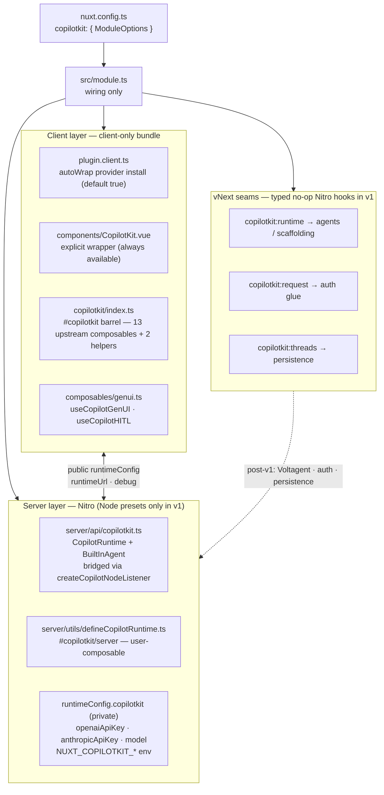

# nuxt-copilotkit — Architecture (v1)

**Date:** 2026-10-23 · **Status:** Validated
**Parent document:** [docs/plans/2026-10-23-nuxt-copilotkit-design.md](./docs/plans/2026-10-23-nuxt-copilotkit-design.md)

This file holds the full architecture detail for the v1 design. The design document carries only a compressed summary and links here.

---

## 1. Layering

Four layers; the module owns **no agent UI logic**, only seams:



> **Erratum (2026-10-23, Spike A):** the barrel carries **21** upstream composables (not 13) and 30 upstream components are registered; module-owned injection keys ship at `#copilotkit/keys` because upstream `CopilotKitKey` is private.

## 2. Config flow (one way)

Module options → `runtimeConfig` → runtime code. Never the reverse, never build-time reads in templates.

- **Public:** `public.copilotkit.runtimeUrl`, `public.copilotkit.debug`
- **Private:** `runtimeConfig.copilotkit.{openaiApiKey, anthropicApiKey, model}`, env-overridable via `NUXT_COPILOTKIT_*` (`NUXT_COPILOTKIT_OPENAI_API_KEY`, `NUXT_COPILOTKIT_MODEL`, …)
- **Single source of truth for the route path:** computed once at setup from `runtime.path` (default `/api/_copilotkit`) → feeds *both* `addServerHandler` (route + `/**`) *and* `public.copilotkit.runtimeUrl`. Provider `runtime-url` can never drift from the registered route.

## 3. SSR boundary

| Mechanism | Role |
|---|---|
| `.client.ts` plugin suffix | `plugin.client.ts` never enters the server bundle |
| `addComponent(..., mode: 'client')` | every upstream component + our wrapper — server renders nothing for them |
| `build.transpile: ['@copilotkit/vue']` | upstream package stays SSR-build-safe |
| `nuxt.options.css` push of `@copilotkit/vue/styles.css` | once, globally (no per-component CSS imports) |

Net: the server bundle never evaluates CopilotKit browser code (spike #2 verifies no import-time side effects upstream).

## 4. vNext seams

Three hooks declared with types in v1, no-op by default — vNext features attach without breaking v1's public API:

| Hook | Consumer (post-v1) |
|---|---|
| `copilotkit:runtime` | agent scaffolding, Voltagent wiring — replace default `BuiltInAgent` construction |
| `copilotkit:request` | auth glue — reject/augment requests with Nuxt session context |
| `copilotkit:threads` | thread persistence (`better-sqlite3` in deps is reserved for this) |

## 5. Files

| File | Responsibility |
|---|---|
| `src/module.ts` | Options wiring, registration, aliases, devtools hook-up (rewritten from stub: `meta.name: 'nuxt-copilotkit'`, `configKey: 'copilotkit'`) |
| `src/options.ts` | `ModuleOptions` types + defaults + `declare module 'nuxt/schema'` runtimeConfig augmentation |
| `src/runtime/plugin.client.ts` | autoWrap provider install |
| `src/runtime/components/CopilotKit.vue` | Explicit wrapper (reads `runtimeConfig.public.copilotkit`, forwards to upstream `CopilotKitProvider`) |
| `src/runtime/copilotkit/index.ts` | `#copilotkit` composables barrel (upstream pass-through + our helpers) |
| `src/runtime/composables/genui.ts` | `useCopilotGenUI`, `useCopilotHITL` |
| `src/runtime/server/api/copilotkit.ts` | Nitro handler (memoized node-listener bridge) |
| `src/runtime/server/utils/defineCopilotRuntime.ts` | Runtime construction util (memoized; server-auto-imported; `#copilotkit/server`) |
| `src/devtools.ts` + `client/` | DevTools tab (id `nuxt-copilotkit`, route `/__nuxt-copilotkit`) |

## 6. ModuleOptions

```ts
interface ModuleOptions {
  runtime: false | {
    enabled: boolean          // default true → built-in route registered
    path: string              // default '/api/_copilotkit' (route + '/**' registered)
    url?: string              // external runtime URL (disables built-in route)
    model?: string            // default 'openai/gpt-4o'
  }
  provider: {
    autoWrap: boolean         // default TRUE (zero-template); false → explicit <CopilotKit>
    debug?: boolean
    inspector?: boolean | 'dev'   // upstream Inspector never runs in SSR/prod
  }
  components: false | {
    prefix?: string           // default ''
    global?: boolean          // default TRUE (required for GenUI by-name resolution)
    include?: string[]        // trim registration; `exclude` deferred (additive later)
  }
  imports: false | { prefix?: string; include?: string[] }   // default: all composables
  styles: boolean             // default true
  devtools: boolean           // default true
}
```
