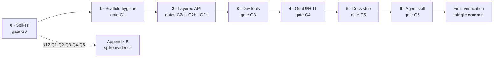

# nuxt-copilotkit — v1 Implementation Plan

> **Sources of truth (author-locked):** `docs/plans/2026-10-23-nuxt-copilotkit-design.md` (design v1) and `ARCHITECTURE.md` (v1). This plan sequences and verifies their locked decisions; it does not re-open them. If this plan and the design doc ever disagree, **the design doc wins** and the gap is raised as a question — never silently patched.

- **Created:** 2026-10-23
- **Branch at creation:** `dev` @ `5951923` (scaffold commit)
- **Execution model:** subagent-driven (SDD) with a single final commit — see `§V. Implementation Approach`

---

## I. Goal

Ship **nuxt-copilotkit v1** per the locked design: an official-quality Nuxt 4.6+ module that wraps `@copilotkit/vue` (v2-generation SDK, peer floor `^1.79.0`) with:

1. **SSR-safe hydration** (D3): server render produces the full page with zero CopilotKit live state and no hydration-mismatch warnings.
2. **Built-in Nitro route** (D2): `CopilotRuntime` + `BuiltInAgent` on `/api/_copilotkit[/**]` (path configurable, disable-able, external-runtime mode), Node-listener bridge, keys via `runtimeConfig.copilotkit` / `NUXT_COPILOTKIT_*`.
3. **Hybrid provider** (D4): `provider.autoWrap: true` by default (zero-template client plugin) + explicit `<CopilotKit>` wrapper component.
4. **Pass-through public surface** (D5/D6): `#copilotkit` composables barrel (+ `#copilotkit/keys` module-owned injection key, G0B1 amendment); upstream components auto-registered via `addComponent` (`export`-from `@copilotkit/vue`, `mode: 'client'`; our own `<CopilotKit>` wrapper is **universal** so its `<slot/>` server-renders); explicit imports via `#components`.
5. **GenUI/HITL Nuxt helpers** (§7): `useCopilotGenUI` + `useCopilotHITL` only (stale `useCopilotRuntimeIdentity`/`threadId` terms confirmed out of scope 2026-10-23).
6. **DevTools tab** (§8): tab id `nuxt-copilotkit`, config snapshot, env booleans, registrations surfaces, health probe.
7. **Docs stub**: reserved `documentation/` directory note only (D10 — docus site deferred post-v1).
8. **Shipped agent skill** (added scope, 2026-10-23): `skills/nuxt-copilotkit/SKILL.md` authored in-repo, published via `files: ["dist", "skills"]` so consumers' `skills-npm` symlinks it.

### Success = design checkpoints, verbatim
No gate-letter labels (A3/A4/B1/B2 proposal was **dropped** on 2026-10-23). Every phase gate below maps onto one or more of:

- **§1 success criteria:** playground chat end-to-end vs `/api/_copilotkit` with SSE streaming verified; SSR never crashes (full HTML, zero live state, no mismatch warnings); `@nuxt/test-utils` vitest fixtures pass (§9); GenUI named-component render tool resolves through Nuxt's auto-component registry in the playground (mock agent route, CI-safe without live LLM key).
- **§4 hydration contract:** SSR vnode tree identical to client intent; client-gated provider/context; degrade policy = one-line dev console hint.
- **§9 test matrix:** `ssr.test.ts`, `route.test.ts`, `registration.test.ts`, `runtime-config.test.ts`, `upstream-drift.test.ts`, `genui.unit.test.ts`.

### Explicitly out of scope for v1
Server-rendered live agent state (D3) · `exclude` component filter (deferred, additive later) · edge runtimes (D9) · docs site build (D10) · vNext hook *consumers* (D7 declares typed no-op seams only) · v1-legacy CopilotKit exports (D1).

---

## II. References

| Ref | What it provides to this plan |
|---|---|
| `docs/plans/2026-10-23-nuxt-copilotkit-design.md` | §1 success criteria, §2 decisions D1–D10, §4 hydration contract, §5 route mechanics, §6 auto-imports, §7 GenUI/HITL, §8 DevTools, §9 test matrix, §10 build order, §12 open-questions ledger |
| `ARCHITECTURE.md` | §1 layering, §2 one-way config flow, §3 SSR boundary, §4 vNext seams, §5 files map, §6 complete `ModuleOptions` |
| `pnpm-workspace.yaml` | Named catalogs `prod`/`dev`, `catalogMode: strict` — every dependency version goes through a catalog (memory decision 2026-10-23) |
| `package.json` | `files: ["dist", "skills"]` (skill ships via npm), `prepare`: `nuxt-module-build build --stub && nuxt-module-build prepare && skills-npm -a 'claude,pi'` |
| DevTools v4 migration guide (`devtools.nuxt.com/module/migration-v4`, applied 2026-10-23) | v4-native API for Phase 3 / P9: `onDevtoolsReady`, `ctx.docks.register`, `ctx.scope().rpc.register`, `getDevToolsRpcClient()` from `@vitejs/devtools-kit/client` (^0.7.6, new catalog dep), host channel `window.parent.__NUXT_DEVTOOLS_HOST__` |
| Memory (2026-10-23 decisions) | Catalog discipline; mermaid-only diagrams; **no direct `tsconfig.json` edits** (Nuxt generates it); extensionless imports (no `.ts` specifiers); sandboxed bash cannot GPG-sign (`ssh-agent: Operation not permitted`) → `--no-gpg-sign` strategy; skills-npm semantics (`./skills/` = shipped source for consumers, symlinked into their agent dirs) |

**Skills to invoke at execution time:** `copilotkit` (Spike A — upstream surface), `copilotkit-cli` (`npx copilotkit verify` before hand-debugging), `nuxt` (module patterns), `vitest` (test config), `writing-skills` (Phase 6 skill authoring), plus process skills `test-driven-development`, `systematic-debugging` (on any failure), `verification-before-completion` (before any gate is claimed green).

---

## III. Design Contract (locked surface this plan verifies)

### Files map (ARCHITECTURE §5)

| File | Responsibility |
|---|---|
| `src/module.ts` | Options wiring, registration, aliases, devtools hook-up (rewritten from stub: `meta.name: 'nuxt-copilotkit'`, `configKey: 'copilotkit'`) |
| `src/options.ts` | `ModuleOptions` types + defaults + `declare module 'nuxt/schema'` runtimeConfig augmentation |
| `src/runtime/plugin.client.ts` | autoWrap provider install |
| `src/runtime/components/CopilotKit.vue` | Explicit wrapper (reads `runtimeConfig.public.copilotkit`, forwards to upstream `CopilotKitProvider`) |
| `src/runtime/copilotkit/index.ts` | `#copilotkit` composables barrel (upstream pass-through + our helpers) |
| `src/runtime/copilotkit/index.ts` | `#copilotkit` composables barrel (upstream pass-through + our helpers) |
| `src/runtime/copilotkit/keys.ts` | `#copilotkit/keys` — module-owned `NuxtCopilotKitKey` + context type + `useNuxtCopilotKit()` (upstream's `CopilotKitKey` is private, SPK-A1) |
| `src/runtime/composables/genui.ts` | `useCopilotGenUI`, `useCopilotHITL` |
| `src/runtime/server/api/copilotkit.ts` | Nitro handler (memoized node-listener bridge) |
| `src/runtime/server/utils/defineCopilotRuntime.ts` | Runtime construction util (memoized; server-auto-imported; `#copilotkit/server`) |
| `src/devtools.ts` + `client/` | DevTools tab (id `nuxt-copilotkit`, route `/__nuxt-copilotkit`) |

Additional files this plan introduces (not in §5): `skills/nuxt-copilotkit/SKILL.md` (+ optional `references/`), `documentation/README.md` (stub), `.pi/state/spikes/*.md` (spike evidence — gitignored process state, never committed), `vitest.config.ts` (root, `defineVitestConfig`).

### ModuleOptions (ARCHITECTURE §6 — verbatim)

```ts
interface ModuleOptions {
  runtime: false | {
    enabled: boolean          // default true → built-in route registered
    path: string              // default '/api/_copilotkit' (route + '/**' registered)
    url?: string              // external runtime URL (disables built-in route)
    model?: string            // default 'openai/gpt-4o'
  }
  provider: {
    autoWrap: boolean         // default TRUE (zero-template); false → explicit <CopilotKit>
    debug?: boolean
    inspector?: boolean | 'dev'   // upstream Inspector never runs in SSR/prod
  }
  components: false | {
    prefix?: string           // default ''
    global?: boolean          // default TRUE (required for GenUI by-name resolution)
    include?: string[]        // trim registration; `exclude` deferred (additive later)
  }
  imports: false | { prefix?: string; include?: string[] }   // default: all composables
  styles: boolean             // default true
  devtools: boolean           // default true
}
```

### Routing surface (design §5 / D2 / D8)

- `runtime` object + `enabled: true` (default) → register `path` and `path/**`, both pointing at `src/runtime/server/api/copilotkit.ts` (filename decoupled from route).
- `runtime.url` set → external runtime mode: register **nothing**; client `public.runtimeUrl` = that URL; `@copilotkit/runtime` **not required**.
- `runtime: false` → same as external but `public.runtimeUrl` must come from elsewhere (documented).
- `@copilotkit/runtime` is a **conditional peer** (D8): when built-in route is enabled, `ensurePeer()` fails with an actionable install error if missing.

### Test matrix (design §9 — verbatim)

| Test | Asserts |
|---|---|
| `ssr.test.ts` | autoWrap SSR: 200, full page HTML, zero live state, no hydration warnings |
| `route.test.ts` | `/api/_copilotkit` + `/**` registered & responding; disabled/external modes register nothing; path override |
| `registration.test.ts` | prefix applied; composables resolve from `#copilotkit`; `#copilotkit/keys` resolves (key + `useNuxtCopilotKit`); `global` default true; `include` trims; `<CopilotKit>` registered universal (not client-only) |
| `runtime-config.test.ts` | `NUXT_COPILOTKIT_*` env plumbing; `public.runtimeUrl` === resolved path |
| `upstream-drift.test.ts` | churn-guard: runtime `Object.keys(await import('@copilotkit/vue/v2'))` (composables `^use[A-Z]`, component objects) vs barrel + registered component list; legacy v1 exports excluded (D1) |
| `genui.unit.test.ts` | name resolution, SSR no-op, dev errors |

Playground = E2E criterion: chat vs `/api/_copilotkit` + mock-agent GenUI page (CI-safe without live key).

---

## IV. Current State Analysis (verified 2026-10-23, against installed packages)

| Fact | Evidence | Plan consequence |
|---|---|---|
| Nuxt **4.6.2**; `nuxt/server` subpath export exists | `nuxt/package.json` exports `./server`; `dist/server/index.d.ts` (`defineEventHandler` `@since 4.6.0`) | Module server-side code imports portable helpers from `nuxt/server` where available (pattern P3) |
| nitropack **2.13.5** → depends on `h3 ^1.15.11` | `.pnpm` resolution + `nitropack/package.json` | `fromNodeMiddleware` is the h3 **v1** name and is correct for v1; `fromNodeHandler` is h3 v2's name (both h3@1.15.11 and h3@2.0.7 exist in the store — design §12 Q3 answered at pattern level; Spike B confirms empirically) |
| `h3` is **not** a root-resolvable dep | `require.resolve('h3')` fails at root | `h3: ^1.15.11` must enter prod catalog + be a **direct dependency** of the module (pnpm strictness; `shamefully-hoist` would mask a phantom import locally and break consumers) |
| `@nuxt/kit` `AddComponentOptions = { name, filePath } & Partial<Component>` | kit `dist/index.d.mts` line 387 | `addComponent({ name, export, filePath: '@copilotkit/vue', mode: 'client', global })` is valid (pattern P8); `addImportsSources` exists (pattern P7) |
| DevTools trio pinned at **^3.4.2** in catalogs (`@nuxt/devtools-kit`, `@nuxt/devtools`, `@nuxt/devtools-ui-kit`; root consumes via `catalog:prod`) | `pnpm-workspace.yaml` lines 7/13/14 (`node_modules` also contains stale `4.0.0-beta.7` copies — reconciled on next `pnpm install`; **not** repo state) | v3 tab/RPC APIs exist at runtime but are deprecated shims under v4 (`NDT_DEP_xxxx` warnings, removed in DevTools v5) → Phase 3 first **upgrades the trio to ^4.0.0** + adds `@vitejs/devtools-kit ^0.7.6`, then codes **v4-native** (P9 rewritten per the migration guide, 2026-10-23) |
| `pnpm-workspace.yaml`: named catalogs only, `catalogMode: strict` | file contents | **P1 hard rule:** catalog first, `catalog:prod`/`catalog:dev` only, never inline ranges |
| `peerDependencies: catalog:` protocol support unverified in this repo | — | Phase 1 task verifies with `pnpm install --lockfile-only`; fallback recorded in-task |
| `.nuxtrc` carries starter line `imports.autoImport=false` | file contents | Would block playground auto-import demos (#copilotkit barrel) — **Phase 1 hygiene item** with a verify step |
| Repo is the **scaffold commit**: `src/module.ts` = `my-module`/`myModule` stub, sample `src/runtime/plugin.ts`, scaffold devtools client | file contents | Phase 1 renames/removes scaffold artifacts before feature work |
| Local git `commit.gpgsign=true`; pi sandboxed bash cannot sign | memory + earlier session | Staging model: agents stage per task; **one final commit** attempted with `--no-gpg-sign`; on failure the exact command is handed to the user (2026-10-23 decision, option 3) |
| `.gitignore` excludes `skills/` | file contents | **Conflicts with Phase 6** (authored skill source must be committed). Phase 6 removes that line — reasoning: the exclusion targeted *symlinked consumer* state; this repo is a skill *producer* (`files` includes `skills/`) |
| `skills/` empty dir exists; `skills-npm@4.1.0` installed | tree + package | Phase 6 authors `skills/nuxt-copilotkit/SKILL.md`; README notes skills-npm is merging into the `skills` CLI (`npx skills experimental_sync`) — migration-watch note only |
| Public-ready posture: repo `.npmrc` → public registry; zero internal references required; no authored-by commit trailers | memory decision 2026-10-23 | Rechecked in the Final Verification hygiene gate |

---
## V. Implementation Approach

### Build order (user-locked 2026-10-23)

The design doc's §10 order is adjusted per the session constraint:

**Spikes → scaffold hygiene → Layered API (agent mode first) → DevTools → GenUI/HITL opinions → Docs stub → Agent skill → Final verification.**

DevTools lands *before* GenUI/HITL (session constraint supersedes design §10 steps 6–7). Consequence, handled deliberately: Phase 3 ships the registrations panel as a **shell** (empty state per §8), and Phase 4 wires the live GenUI/HITL registry data into it.

### Spike-first, evidence-driven

Phase 0 resolves every `⟪SPK-A⟫` / `⟪SPK-B⟫` marker in Appendix A to exact upstream identifiers/versions before any build task starts. Findings are recorded in `.pi/state/spikes/` (Appendix B template; gitignored — spike notes are process state, not repo docs). If a spike finding contradicts the design doc → **stop and raise with the user** (design wins; plan/deviations need explicit approval).

### SDD execution protocol (user constraints, 2026-10-23)

1. **Before any dispatch:** enumerate available sub-agents and models (`/subagents-models`) and get the model confirmed **per dispatch** by the user.
2. Each task → a focused subagent with a **narrow file scope** (listed files only; they read nothing else without returning to ask) and a **self-review prompt** ("re-read each acceptance criterion in the task and verify it against your diff before reporting").
3. **Parallelize only where file overlap is zero** (SDD rule). The parallelization map below is the authority; if reality diverges, return to sequential and note why.
4. Sub-agent failure or ambiguity → report to the user; never improvise past it.
5. TDD per the §9 matrix where a task carries a test file; `pnpm lint` (auto-fix) is the style arbiter — never hand-tune formatting; verification-before-completion discipline at every gate.

### Parallelization map

| Group | Tasks (parallel within a group) | Why safe |
|---|---|---|
| P0 | 0.1 (Spike A) ∥ 0.2 (Spike B), except catalog edits land once (0.2 owns `pnpm-workspace.yaml`/`package.json`) | disjoint file sets except manifests |
| P1 | 1.1→1.2→1.3 sequential; then 1.4 ∥ 1.5 | shared `module.ts` in 1.1–1.3; docs/tests disjoint after |
| P2 | L1 sequential (2.1–2.5) → Layer 2: 2.5b → (2.6 ∥ 2.7 ∥ 2.8) → 2.9 → tests; Layer 3 after G2b | Layer-2 trio touches disjoint runtime files; registration pass touches `module.ts` alone |
| P3 | 3.1 → 3.2 ∥ 3.3 | devtools module wiring first; client UI vs module option disjoint after |
| P4 | 4.1 → (4.2 ∥ 4.3) → 4.4 | composables first; barrel + devtools wiring disjoint; tests last |
| P5–P6 | sequential | tiny phases, gates between |

### Staging & commit strategy (user decision, option 3)

- Subagents **stage** their changes (`git add <files>`) at each task's end; **no commits** during phases.
- At Final Verification, the orchestrator runs **one** commit: `git commit --no-gpg-sign -m "<message>"` (no authored-by trailers ever). If signing/commit fails in the sandbox, print the exact command for the user to run in their own terminal and proceed with review.

### Verification-first

Every phase ends in a gate with concrete commands. A gate is green **only** with command output as evidence (external-verify discipline): `pnpm lint`, `pnpm test`, `pnpm prepack` as applicable, plus the phase's manual checkpoint where one exists.

---

## VI. Phase Overview



| Phase | Scope | Gate | Design checkpoint(s) |
|---|---|---|---|
| 0 | Spike A (@copilotkit/vue boundary) + Spike B (Nitro↔runtime SSE) | G0 | §12 ledger answers; unblocks build |
| 1 | Renames, `.nuxtrc`, catalogs sanity, fixture, playground reset | G1 | §10 housekeeping; repo green |
| 2 | Layer 1 server (route/utils/hooks/env) → Layer 2 client (plugin/wrapper/barrel/registration) → Layer 3 playground | G2a/G2b/G2c | §1 (route, SSR, hydration), §4 contract, §9 route/registration/ssr/runtime-config/drift tests |
| 3 | DevTools tab — §8's three panels (Config / Registrations-shell / Docs) | G3 | §8 |
| 4 | `useCopilotGenUI` / `useCopilotHITL` + registries + devtools wiring + drift guard | G4 | §1 GenUI criterion, §7 behaviors, §9 genui.unit |
| 5 | `documentation/README.md` stub (D10) | G5 | §13 locked convention |
| 6 | `skills/nuxt-copilotkit/SKILL.md` + `.gitignore` fix + pack/tarball proof | G6 | Ship-with-package skill scope (added 2026-10-23) |

---

## VII. Implementation Phases

> Every phase lists: **Objective · Evidence · Tasks (files + acceptance) · Tests · Verification · Commit**.
> `⟪SPK-A⟫` / `⟪SPK-B⟫` = identifier settled by that spike's findings (Phase 0). `VERIFY` = assumption to confirm at task time with a cited command.

### Phase 0 — Spikes (evidence-first)

- **Objective:** convert the design doc's §12 open questions and every Appendix-A marker into verified facts before the build.
- **Evidence:** two spike notes under `.pi/state/spikes/` (Appendix B templates, gitignored — never committed), each ending in a go/adjust recommendation.

**0.1 — Spike A: `@copilotkit/vue` boundary probe** *(invoke the `copilotkit` skill; run `npx copilotkit verify` first if a runtime is briefly stood up)*

- Files: `.pi/state/spikes/2026-10-23-spike-a-vue-boundary.md` (new, gitignored); may briefly touch `playground/` + `pnpm-workspace.yaml`/`package.json` to install — catalog discipline applies.
- Steps: install `@copilotkit/vue` (prod catalog, floor `^1.79.0`); read its `package.json` exports + `index.d.ts`; record: (a) headless context-install surface (plugin export? injection key? `CopilotKitProvider` props incl. `runtimeUrl`/`debug`/`inspector`), (b) the exact **13 composable** export names, (c) the exact **~20 component** export names (+ named-vs-default export shape for `addComponent`), (d) `styles.css` subpath, (e) server-import safety (import chain under Node SSR), (f) `useRenderTool` + `useHumanInTheLoop` signatures → the §7 wrapper seam.
- Acceptance: Appendix-B table filled for every `⟪SPK-A⟫` marker; SSR-safe import statement proven (or flagged as autoWrap-degrade risk per §4 policy).
- **Result (2026-10-23, reviewer-audited + orchestrator-verified; note v2):** provider-only (no plugin; `CopilotKitKey` private) ⇒ §4 degrade active; **21** v2 composables (17 hooks + 4 provider incl. `useCopilotKit`); **30** component exports (28 UI + 2 providers; 7 internal SFCs unexported); `@copilotkit/vue/styles.css` ✓; SSR import ✓. Evidence: `.pi/state/spikes/2026-10-23-spike-a-vue-boundary.md`.

**0.2 — Spike B: Nitro handler ↔ `CopilotRuntime` SSE proof**

- Files: `.pi/state/spikes/2026-10-23-spike-b-nitro-sse.md` (new, gitignored); owns `pnpm-workspace.yaml` + `package.json` catalog/devDep edits; minimal probe route in `playground/`.
- Steps: add `@copilotkit/runtime` + `h3 ^1.15.11` to prod catalog (this task is the single owner of manifest edits in Phase 0); construct `CopilotRuntime` + `BuiltInAgent({ model: 'openai/gpt-4o' })` (settles §12 Q4); mount `createCopilotNodeListener({ runtime })` via `fromNodeMiddleware` in a Nuxt route; `curl -N` a POST and record the raw SSE stream shape (settles §12 Q1 listener subpaths, observed empirically); probe `GET /api/_copilotkit` → record health semantics (settles §12 Q5); probe whether `GET .../info` exists (devtools health panel input, §8).
- Acceptance: SSE round-trip demonstrated (paste of actual output in the note); exact `@copilotkit/runtime` version + `/v2/node` import string recorded; `h3` import string recorded; go/adjust on the P3 pattern.

**⚠️ Blockers this phase must surface (they are design-critical):** (i) **[RESOLVED by Spike A]** `@copilotkit/vue` has no headless plugin and keeps `CopilotKitKey` private (SSR import itself is safe) → the §4 degrade policy is the active autoWrap behavior (one-line dev hint; Path B `<CopilotKit>` is the real provider path); (ii) `BuiltInAgent` model string ≠ `'openai/gpt-4o'` format → update ARCHITECTURE §6 default note; (iii) `/v2/node` subpath renamed → route file follows spike, drift test follows.

- **Tests:** none (spikes only).
- **Verification:** both notes exist; Appendix-B marker table 100% resolved; user signs off go/adjust.
- **Commit:** stage manifest changes only — spike notes stay in gitignored `.pi/state/spikes/`, never staged (no commit — final commit only).

**Gate G0** = user-approved go/adjust + resolved marker table.

---

### Phase 1 — Scaffold hygiene

- **Objective:** transform the `@nuxt/module-builder` scaffold into the `nuxt-copilotkit` skeleton without touching feature surface; repo fully green.
- **Evidence:** lint/test/prepack output captured in the phase report.

**1.1 — renames + skeleton** — `src/module.ts` (meta `name: 'nuxt-copilotkit'`, `configKey: 'copilotkit'`, `compatibility: { nuxt: '>=4.6.0' }`; empty-but-typed `setup` that consumes `src/options.ts`), `src/options.ts` (exact `ModuleOptions` from §III + `defaults` + `declare module 'nuxt/schema'` augmentation for `RuntimeConfig.copilotkit` / `PublicRuntimeConfig.copilotkit`), delete scaffold `src/runtime/plugin.ts` (sample) and any scaffold server leftovers. *Acceptance:* `pnpm dev:prepare` regenerates types with zero errors; no `myModule`/`my-module` strings remain (`rg -i 'my-?module'`). **Do not edit `tsconfig.json`** — Nuxt-generated.

**1.2 — `.nuxtrc` + auto-import verification** — remove the starter line `imports.autoImport=false` **after** verifying the playground relies on auto-imports for the future `#copilotkit` barrel (record the verify result in the task report; if a knock-on breaks `basic.test.ts`, keep removal but fix the fixture in 1.4 — removal is the target state since design §9 `registration.test.ts` asserts `#copilotkit` resolution).

**1.3 — devtools scaffold rename** — `src/devtools.ts` + `client/`: ids/titles → `nuxt-copilotkit` / `/__nuxt-copilotkit` (§10 housekeeping only; full UI is Phase 3). *Acceptance:* `pnpm dev` boots playground with a placeholder tab; no `NTip` scaffold usages remain.

**1.4 — playground + fixture reset** — `playground/app.vue` → minimal SSR demo page (plain prose + marker element for §9 `ssr.test.ts` HTML assertions, wired in Phase 2); `test/fixtures/basic/` → new minimal fixture mirroring the module's real shape. Root `vitest.config.ts` (new file) via `defineVitestConfig` from `@nuxt/test-utils/config` — owns the §9 matrix incl. the Phase-4 `genui.unit.test.ts` pragma (plan-check W2 fix). *Acceptance:* `pnpm dev` renders the playground page.

**1.5 — manifest sanity + catalog protocol verification** — `pnpm install --lockfile-only` to confirm `peerDependencies: "catalog:prod"` resolves on this pnpm (`VERIFY`: if unsupported, peers get explicit floors per design §11 with a plan note); confirm `files` still `["dist", "skills"]`; root `name`/`description` final; `client`/`playground` names already `nuxt-copilotkit-*` per memory — verify and record.

- **Tests:** existing `pnpm test` smoke stays green (fixture swap per 1.4).
- **Verification:** `pnpm dev:prepare && pnpm lint && pnpm test && pnpm prepack` all exit 0; `rg -i 'my-?module|johndoe'` empty; `git add -A`.
- **Commit:** stage only.

**Gate G1** = green toolchain on the renamed scaffold.

---
### Phase 2 — Layered API (agent mode first, then layered client surface)

- **Objective:** deliver the full client/server layered API exactly per design §4–§6 + ARCHITECTURE §1–§4, closing §1 criteria 1–3 and the §4 hydration contract.
- **Evidence:** layer gates below + §9 tests `route.test.ts` / `registration.test.ts` / `ssr.test.ts` / `runtime-config.test.ts` / `upstream-drift.test.ts` all green with captured output.

#### Layer 1 — server (route, utils, vNext hooks, env)

**2.1 — module wiring (`src/module.ts`)** per P2: resolver; one-way config options → runtimeConfig (private keys `runtimeConfig.copilotkit`, public `runtimeConfig.public.copilotkit` with `runtimeUrl` resolved from **one** source per ARCHITECTURE §2 and `debug`); aliases `#copilotkit` → `src/runtime/copilotkit` and `#copilotkit/server` → `src/runtime/server/utils`; `build.transpile` += `@copilotkit/vue`; `styles` ⇒ `css` += `@copilotkit/vue/styles.css` (SPK-A4 ✓ `package.json:57`) path; `runtime === false | url` ⇒ **no** `addServerHandler`; else add `route` + `route/**` → `src/runtime/server/api/copilotkit.ts` (filename decoupled). *Acceptance:* external/disabled modes register nothing (asserted by `route.test.ts`).

**2.2 — env plumbing** — `NUXT_COPILOTKIT_*` per design §5/§9: `runtime-config.test.ts` asserts env → config and `public.runtimeUrl` === resolved path. Env names recorded in options docs (TSDoc).

**2.3 — server utils (`src/runtime/server/utils/defineCopilotRuntime.ts`)** per P4: `defineCopilotRuntime(factory)` + `getCopilotRuntime(event)`; default `BuiltInAgent({ model: <options.runtime.model ?? 'openai/gpt-4o'> })` (model-string format `'openai/gpt-4o'` confirmed — a literal of `BuiltInAgentModel`, Spike B SPK-B4); memoized; default agent registered under key `'default'` (`DEFAULT_AGENT_ID` from `@copilotkit/shared`, so zero-config `<CopilotChat />` connects with no `agent-id`); `apiKey` chosen from runtimeConfig by the model's provider prefix (`anthropic/…` → `anthropicApiKey`, otherwise `openaiApiKey`; `undefined` lets `BuiltInAgent` fall back to the env var); `getCopilotRuntime` is **async** (awaits the `copilotkit:runtime` hook); server-auto-imported (`VERIFY`: confirm nitro auto-import of module `runtime/server/utils` on nuxt 4.6.2 — starter precedent — else ship alias-only and document explicit `#copilotkit/server` import); re-exported from `#copilotkit/server`.

**2.4 — handler (`src/runtime/server/api/copilotkit.ts`)** per P3: `defineEventHandler` and `fromNodeMiddleware` both from `h3` (matches Design §5; `event` is typed `H3Event`, matching `getCopilotRuntime(event: H3Event)`; value export confirmed at h3@1.15.11, Spike B SPK-B3); `createCopilotNodeListener` from `@copilotkit/runtime/v2/node` (subpath confirmed at @copilotkit/runtime@1.79.1, Spike B SPK-B1); async handler (awaits `copilotkit:request` per request and `await getCopilotRuntime(event)` on first init); file-level lazy memoization; registered at both `route` and `route/**` (P2) — the bare mount path returns 404 from the listener and `GET <mount>/info` is the 200 info/health endpoint (Spike B); `ensurePeer('@copilotkit/runtime', 'pnpm add -D @copilotkit/runtime')` with actionable error when built-in enabled (D8). *Acceptance:* POST SSE observed in playground (G2a).

**2.5 — vNext typed no-op hooks (D7, ARCHITECTURE §4)** — `declare module 'nitropack' { interface NitroRuntimeHooks { 'copilotkit:runtime' / 'copilotkit:request' / 'copilotkit:threads' } }` (payloads: `copilotkit:runtime` `{ event: H3Event; agents: Record<string, AbstractAgent> }`, `copilotkit:request` `(event: H3Event)`, `copilotkit:threads` `{ event: H3Event; threadId?: string }` — `VERIFY` the `AbstractAgent` import path at task time; nitropack-v2 surface — 'nitro/types' is the Nitro-v3 future, skill-verified); hooks fired from 2.3/2.4 via `useNitroApp().hooks.callHook`; callable with **zero** listeners; no behavior. *Acceptance:* typecheck passes; a dev-only `console.debug` behind the `debug` option proves the hook chain.

**Tests (L1):** `test/route.test.ts` (registered + responding — built-in w/ mocked `@copilotkit/runtime`; disabled mode & external mode register nothing; `runtime.path` override), `test/runtime-config.test.ts`.

**Verification (G2a):** `pnpm test` for the L1 files green; live playground `curl -N` SSE paste.

#### Layer 2 — client (plugin, wrapper, barrel, registration pass)

**2.5b — keys (`src/runtime/copilotkit/keys.ts`)** per P7b *(user amendment at G0B1)*: module-owned `NuxtCopilotKitKey: InjectionKey<NuxtCopilotKitContext>`, the context type (= public runtimeConfig: `runtimeUrl`, `debug` — no secrets) and `useNuxtCopilotKit()`; exposed at `#copilotkit/keys` (resolves through the existing `#copilotkit` directory alias — `VERIFY` vite + generated tsconfig paths; else add an explicit alias). Upstream's own `CopilotKitKey` cannot be exported (private Symbol, SPK-A1). Must land **before** 2.6 (the plugin imports it).

**2.6 — autoWrap plugin (`src/runtime/plugin.client.ts`)** per P5 (SPK-A1 resolved): upstream offers no headless install and its injection key is private, so the plugin (a) provides the **module-owned** context via `vueApp.provide(NuxtCopilotKitKey, …)` and (b) applies the §4 degrade policy — one-line dev console hint pointing at `<CopilotKit>` (Path B). SSR vnode tree identical (no root wrapping); installed when `provider.autoWrap !== false`.

**2.7 — wrapper (`src/runtime/components/CopilotKit.vue`)** per P6 (SPK-A1 resolved; **design-wins fix**): a **universal** component — registered **without** `mode: 'client'`, `global: true`, name `${prefix}CopilotKit` — because Nuxt's client mode emits `<!---->` on the server and would blank the `<slot/>` (violates Design §4 / §1 criterion 2). Renders `<slot/>` on SSR **and** during hydration; after `onMounted` it switches to upstream `CopilotKitProvider` (forwarding `runtimeUrl`/`debug` from `runtimeConfig.public.copilotkit`, `$attrs` pass-through). `VERIFY` in `ssr.test.ts`: slot-remount cost on switch; whether the provider can render unconditionally; how `provider.inspector` reaches `enableInspector` (public config carries only `runtimeUrl` + `debug`, ARCHITECTURE §2).

**2.8 — barrel (`src/runtime/copilotkit/index.ts`)** per P7: pass-through re-exports of the **21** upstream v2 composables (SPK-A2: 17 from `hooks/` + `useCopilotKit`, `useCopilotChatConfiguration`, `useLicenseContext`, `useSandboxFunctions` from `providers/`) plus their companion types; legacy v1 `useCopilotAction`/`useCopilotReadable` excluded (D1); + (Phase-4 added) our 2 helpers; no side effects; TSDoc on the re-export block noting drift-guard coverage.

**2.9 — registration pass (`src/module.ts`)** per P8 with the SPK-A3 component list (**30** runtime-exported v2 components: 28 UI + `CopilotKitProvider` + `CopilotChatConfigurationProvider`; never the 7 unexported internal SFCs, never legacy v1 `CopilotKit`): `addComponent({ name: prefix+name, export: name, filePath: '@copilotkit/vue', mode: 'client', global: components.global ?? true })`, `include` trims; `addImportsSources({ from: '#copilotkit', imports: [...] })` honoring the `imports` option (`prefix`/`include`/false). Also registers 2.6's plugin explicitly here: `if (options.provider.autoWrap !== false) addPlugin(resolve('./runtime/plugin.client'))` — Nuxt never auto-scans module runtime plugins (plan-check W1 fix). *Acceptance:* `registration.test.ts` green.

**Tests (L2):** `test/registration.test.ts`, `test/ssr.test.ts` (200 + full page HTML + zero live state + no hydration warnings — §1 criterion 2 & §4 contract), `test/upstream-drift.test.ts` (diffs 2.8 barrel + 2.9 component list against the **runtime** exports of installed `@copilotkit/vue/v2` — §6 churn guard; excludes legacy v1 exports per D1).

**Verification (G2b):** `pnpm test` suite green incl. the L2 trio; `pnpm prepack` clean.

#### Layer 3 — playground E2E + layered surface proof

**2.10 — playground** per §1 criteria 1 & 4 and the §9 E2E line: chat page against `/api/_copilotkit`; mock-agent GenUI page (CI-safe, no live key); local keys via gitignored playground `.env` (document, never commit).

**2.11 — layered manual matrix** — agent-mode-first sanity pass across: built-in route (default), external URL mode, `runtime: false`, `provider.autoWrap: false` + explicit `<CopilotKit>`, prefix/include trims — outcomes pasted into the phase report.

**Verification (G2c):** G2a + G2b outputs + playground E2E recorded (chat SSE trace; GenUI mock resolution).

- **Commit:** stage only.

---

### Phase 3 — DevTools

- **Objective:** design §8 verbatim — in-app devtools tab, **read-only**, exactly three panels: **Config** (resolved options + `public.copilotkit` + redacted env presence booleans), **Registrations** (components/imports/active GenUI tools/pending HITL + route URL & health probe — shelled until Phase 4 wires the registries; ordering per user constraint), **Docs** (docs-page capability linking toward the deferred docus site, D10). No panel split-outs, no fourth panel.
- **Evidence:** G3 checklist + capture of the panels in the dev playground.

**3.1 — tab (`src/devtools.ts`)** per P9 (**v4-native**, migration-guide applied): **first the catalog step** — bump `@nuxt/devtools-kit` / `@nuxt/devtools` / `@nuxt/devtools-ui-kit` ^3.4.2 → ^4.0.0 in `pnpm-workspace.yaml`, add `@vitejs/devtools-kit ^0.7.6` (prod catalog, consumed by `client` deps), `pnpm install` (clears the stale beta copies from the store), dedupe check if the ui-kit still resolves at two versions; then `onDevtoolsReady((ctx) => { ctx.docks.register({ id: 'nuxt-copilotkit', title: 'CopilotKit', icon: 'carbon:bot', type: 'iframe', url: '/__nuxt-copilotkit', groupId: NUXT_DEVTOOLS_GROUP_ID, category: 'modules' }) })`; server RPC via `ctx.scope('nuxt-copilotkit').rpc.register({ name: 'get-config' | 'get-env-flags' | 'get-health' ⟪per Spike-B Q5⟫, type: 'query', handler })`; guarded by `options.devtools` (default true). *Acceptance:* no deprecated v3 API used (zero `NDT_DEP_*` warnings in the dev terminal; `NDT_DEP_0003`/`0005`/`0007` are the ones this integration would hit).

**3.2 — panels (`client/`)** — exactly the §8 trio. iframe talks to the dock via `getDevToolsRpcClient()` from `@vitejs/devtools-kit/client` (`kit.scope('nuxt-copilotkit').rpc.call('get-config')`, etc.): **Config** = resolved `ModuleOptions` + `public.copilotkit` snapshot + `NUXT_COPILOTKIT_*` presence booleans (never values); **Registrations** = components/imports/GenUI tools/pending HITL lists + route URL + health probe (per Spike-B Q5 semantics) — empty-state shell until Phase 4; **Docs** = docs-page with links toward the deferred docus site (placeholder pointing at `ARCHITECTURE.md`/design doc paths). Every panel honors the §8 empty state. Host channel reserved for Phase 4: `window.parent.__NUXT_DEVTOOLS_HOST__` (same-origin; `undefined` outside DevTools — panels must degrade gracefully).

**3.3 — module hook-up (`src/module.ts`)** — register `src/devtools.ts` only when `options.devtools && nuxt.options.dev`; lazy-import so prod builds never touch devtools-kit. Consumer posture: requires DevTools v4 (Nuxt 4.5+; module floor is 4.6 — satisfied); on DevTools v3 the integration silently does not register (documented v4 behavior, no shim warnings by design).

- **Tests:** none in §9 (dev-only surface); typecheck + dev smoke instead.
- **Verification:** `pnpm dev` → tab opens, all three §8 panels render, empty states correct, health probe matches the Spike-B observation, Docs panel placeholder present; `pnpm prepack` still ships only `dist` + `skills` (files array unchanged).
- **Commit:** stage only.

**Gate G3** = panels live in the dev playground.

---

### Phase 4 — GenUI/HITL opinions

- **Objective:** design §7 — `useCopilotGenUI` + `useCopilotHITL`, the client registries, devtools population, and the last §9 test file.
- **Evidence:** `genui.unit.test.ts` green; playground GenUI criterion (§1 #4) reproducible; Phase-3 registrations panel now shows data.

**4.1 — helpers (`src/runtime/composables/genui.ts`)** per P7 (SPK-A6 ✓ signatures): `useCopilotGenUI(...)` wraps upstream `useRenderTool`; `useCopilotHITL(...)` wraps upstream `useHumanInTheLoop`; `import.meta.server` early-return (§7.2 SSR no-op); string component names resolve via `resolveComponent` — unresolved ⇒ explicit dev error naming the component + the `components.global: true` reminder (§7.3); missing provider context (autoWrap:false without an explicit `<CopilotKit>` wrapper) ⇒ one-line dev warning per §7.3 (plan-check W3 fix); registrations recorded in `useState('copilotkit:genui-tools' | 'copilotkit:hitl-actions', ...)` (never module-level refs).

**4.2 — barrel update** — export the two helpers from `src/runtime/copilotkit/index.ts`; extend the `addImportsSources` list; extend `upstream-drift.test.ts` coverage to the helpers block.

**4.3 — devtools registrations wiring** — the Phase-3 shell reads the app's `copilotkit:genui-tools` / `copilotkit:hitl-actions` `useState` registries through the same-origin host channel `window.parent.__NUXT_DEVTOOLS_HOST__` (v4-guide-verified mechanism; read-only per §8; degrade to the Phase-3 empty state when the host object is absent).

**4.4 — playground GenUI page** — mock-agent route rendering a by-name component through the registry (§1 criterion 4; CI-safe).

- **Tests:** `test/unit/genui.unit.test.ts` — `// @vitest-environment nuxt` pragma + root `vitest.config.ts` via `defineVitestConfig` from `@nuxt/test-utils/config` (vitest skill); `mountSuspended` for component probes; asserts name resolution, SSR no-op, dev-error text.
- **Verification:** `pnpm test` full matrix green (6/6); §1 criterion 4 evidence recorded.
- **Commit:** stage only.

**Gate G4** = §9 matrix fully green + GenUI criterion met.

---
### Phase 5 — Docs stub

- **Objective:** the reserved-directory note only (decision 2026-10-23; D10 keeps the docus build deferred post-v1).
- **Evidence:** file exists with zero fabricated API claims.

**5.1 — `documentation/README.md`** — states: `documentation/` is reserved as the future docs-app root (docus on `@nuxt/content`, decision locked, phase deferred); published markdown will live in `documentation/content/`; internal design/planning docs stay in `docs/plans/` and are never published (fully separate trees, §13); diagrams use mermaid; links to `ARCHITECTURE.md` + the design doc.

- **Tests:** none.
- **Verification:** read-back check against §13 wording; no API surface described beyond what v1 shipped (prevent doc drift on day one).
- **Commit:** stage only.

**Gate G5** = stub present, accurate, free of internal references.

---

### Phase 6 — Module agent-skill

> **Note (author-requested):** this phase starts **only after the module is finished** (Phases 1–5 complete) — the skill documents the final public surface (`#copilotkit` barrel exports, `#copilotkit/keys`, component list, `ModuleOptions`, route modes, `NUXT_COPILOTKIT_*` env vars, DevTools panels, GenUI/HITL helpers). Writing it earlier would guarantee rework. Subagent invokes the `writing-skills` skill before authoring.

- **Objective:** `skills/nuxt-copilotkit/SKILL.md` so end-users' agents (via `skills-npm`) get accurate, version-matched guidance when consuming the module — per the skills-npm convention (`skills/` inside the npm package → symlinked into the consumer's agent skills dir).
- **Evidence:** G6 proofs below.

**6.1 — un-gitignore the source** — remove `skills/` from `.gitignore`. *Reasoning (recorded, guard-removal rule):* that exclusion was written for **symlinked consumer-side** skills state; this repo is a **producer** (`package.json → files: ["dist", "skills"]`), so `./skills/` is authored source and must be committed.

**6.2 — author the skill** — `skills/nuxt-copilotkit/SKILL.md`: YAML frontmatter (`name: nuxt-copilotkit`, `description` with trigger phrases: building Nuxt apps with CopilotKit, runtime route setup, GenUI/HITL, devtools, debugging integration); body sections: install & enable · options reference · provider models (autoWrap vs `<CopilotKit>`) · route modes + env keys · server utils (`#copilotkit/server`, `defineCopilotRuntime`) · GenUI/HITL helpers · DevTools tab · troubleshooting (ensurePeer error, hydrate-safety notes). `references/` subfiles only if size demands (writing-skills conventions decide).

**6.3 — verify** — run `pnpm prepare` (which runs `skills-npm -a 'claude,pi'`) and confirm the skill symlinks into local agent dirs; `npm pack --dry-run` lists `skills/nuxt-copilotkit/SKILL.md` in the tarball; `rg -i '<internal-domain-patterns>' skills/` returns empty (public hygiene).

- **Tests:** none; verification is the proofs above.
- **Dep-watch note (no action):** `skills-npm` is merging into the `skills` CLI (`npx skills experimental_sync`); migration is upstream-initiated later.
- **Verification:** the three 6.3 proofs pasted in the phase report.
- **Commit:** stage only.

**Gate G6** = skill discoverable via skills-npm + present in packed tarball.

---

## VIII. Final Verification (all phases done)

1. `pnpm dev:prepare && pnpm lint && pnpm test && pnpm prepack` — exit 0, output captured.
2. `npm pack --dry-run` — tarball contains `dist/**` + `skills/nuxt-copilotkit/SKILL.md`, nothing extraneous.
3. **§1 success-criteria mapping table** — each of the 4 criteria → the concrete evidence produced (file lines / pasted traces) in G0–G6 phase reports:
   | # | Criterion | Evidence from |
   |---|---|---|
   | 1 | Playground chat SSE vs `/api/_copilotkit` | G2a/G2c recorded trace |
   | 2 | SSR never crashes (full HTML, zero live state, no mismatch) | `ssr.test.ts` (G2b) |
   | 3 | `@nuxt/test-utils` fixtures pass | `pnpm test` (6/6 §9 files) |
   | 4 | GenUI named-component via auto-registry (mock agent) | G4 playground page |
4. **§4 hydration contract checklist** — identical SSR vnode tree; degrade hint policy implemented; `autoWrap:false` path documented in phase report.
5. **§12 ledger status** — Q1–Q5 each marked answered-by (spike note / task) or consciously deferred.
6. **Public hygiene** — no `authored-by`/co-authored trailers; zero internal references (`rg -i` sweep for internal hosts/tooling names across committed files); `.npmrc` still points at the public registry.
7. **Single final commit** — `git add -A && git commit --no-gpg-sign -m "feat: nuxt-copilotkit v1 — layered API, devtools tab, GenUI/HITL helpers, agent skill"` (message finalized at commit time). If the sandbox cannot commit, print the exact command for the user's terminal and stop there.
8. Record the session handoff per the user's handoff convention (template `~/.pi/agent/prompts/session-handoff.md`).

---

## Appendix A — Domain Coding Patterns (approved 2026-10-23, verbatim)

> These patterns were validated against the **installed** packages (nuxt 4.6.2, nitropack 2.13.5 → h3 ^1.15.11, @nuxt/kit, @nuxt/devtools-kit). `⟪SPK-A⟫`/`⟪SPK-B⟫` markers resolve during Phase 0; `VERIFY` means confirm at task time with the cited check.

### P1 — Deps via catalogs (hard rule)

```yaml
# pnpm-workspace.yaml — add to named catalog FIRST, never inline a range
catalogs:
  prod: { '@copilotkit/vue': ^1.79.0, '@copilotkit/runtime': ^1.79.1, 'h3': ^1.15.11 }
```

```jsonc
// package.json — reference only; peer floor via catalog; runtime is OPTIONAL peer
"dependencies": { "h3": "catalog:prod" },
"peerDependencies": { "@copilotkit/vue": "catalog:prod", "@copilotkit/runtime": "catalog:prod" },
"peerDependenciesMeta": { "@copilotkit/runtime": { "optional": true } },
"devDependencies": { "@copilotkit/vue": "catalog:prod", "@copilotkit/runtime": "catalog:prod" }
```

*Verified: catalogMode strict; h3^1.15.11 is nitropack@2.13.5's h3 line — direct dep declaration avoids phantom-import under pnpm (shamefully-hoist masks it locally). peerDeps catalog protocol support verified at task time (`pnpm install --lockfile-only`).*

### P2 — Module wiring (`src/module.ts` + `src/options.ts`)

```ts
export default defineNuxtModule<ModuleOptions>({
  meta: { name: 'nuxt-copilotkit', configKey: 'copilotkit', compatibility: { nuxt: '>=4.6.0' } },
  defaults: { /* ARCHITECTURE §6 defaults */ },
  setup(options, nuxt) {
    const { resolve } = createResolver(import.meta.url);
    const routePath = options.runtime === false ? null : (options.runtime.path ?? '/api/_copilotkit');
    // one-way config: options → runtimeConfig (never reverse)
    nuxt.options.runtimeConfig.copilotkit = defu(/* private keys */);
    nuxt.options.runtimeConfig.public.copilotkit = { runtimeUrl: /* resolved, single source */, debug: options.provider.debug };
    nuxt.options.alias['#copilotkit'] = resolve('./runtime/copilotkit');
    nuxt.options.build.transpile.push('@copilotkit/vue');
    if (options.styles) nuxt.options.css.push('@copilotkit/vue/styles.css');
    if (options.provider.autoWrap !== false) addPlugin(resolve('./runtime/plugin.client')); // 2.6's file; Nuxt does NOT auto-scan module runtime plugins (plan-check W1)
    if (routePath) { addServerHandler({ route: routePath, handler: resolve('./runtime/server/api/copilotkit') });
                     addServerHandler({ route: `${routePath}/**`, handler: /* same file */ }); }
  }
});
```

*Rules: filename decoupled from route (§5); path computed once, shared by registration + client (ARCHITECTURE §2); runtimeConfig augmentation lives in `options.ts` via `declare module 'nuxt/schema'`.*

### P3 — Nitro handler (node-listener bridge)

```ts
import { defineEventHandler, fromNodeMiddleware } from 'h3'; // h3 v1 names (h3@2 calls fromNodeMiddleware `fromNodeHandler`); matches Design §5; event: H3Event (Spike B SPK-B3)
import { getCopilotRuntime } from '../utils/defineCopilotRuntime';
import { createCopilotNodeListener } from '@copilotkit/runtime/v2/node'; // subpath confirmed at @copilotkit/runtime@1.79.1 (Spike B SPK-B1)

let handler: ReturnType<typeof fromNodeMiddleware> | null = null;
export default defineEventHandler(async (event) => {
  await useNitroApp().hooks.callHook('copilotkit:request', event); // no-op with zero listeners; useNitroApp import path: VERIFY (nitropack/runtime on nitropack 2.13.5)
  if (!handler) handler = fromNodeMiddleware(createCopilotNodeListener({ runtime: await getCopilotRuntime(event) }));
  return handler(event);
});
```

*Verified: nitropack 2.13.5 pins h3 ^1.15.11 → `fromNodeMiddleware` exists there; `fromNodeHandler` is h3 v2's name (§12 Q3 resolved at pattern level, Spike B confirms empirically). Explicit imports everywhere — repo `.nuxtrc` disables auto-imports, so no reliance on them in module runtime code. (That `.nuxtrc` line also gates the *playground's* auto-import demos — Phase 1 hygiene item 1.2 with a verify step.)*

### P4 — Server utils + vNext typed hooks

```ts
// src/runtime/server/utils/defineCopilotRuntime.ts → auto-imported + re-exported from #copilotkit/server
export function defineCopilotRuntime(factory: CopilotRuntimeFactory) { /* register & memoize */ }
export async function getCopilotRuntime(event: H3Event) { /* BuiltInAgent registered as agents.default (DEFAULT_AGENT_ID), model string 'openai/gpt-4o' (Spike B SPK-B4), apiKey by provider prefix; awaits copilotkit:runtime */ }
```

```ts
// vNext seams (D7): declared now, no-op by default
declare module 'nitropack' {   // nitropack v2 surface; 'nitro/types' is the Nitro-v3 future (skill ref)
  interface NitroRuntimeHooks {
    'copilotkit:runtime': (ctx: { event: H3Event; agents: Record<string, AbstractAgent> }) => void | Promise<void>;   // VERIFY AbstractAgent path
    'copilotkit:request': (event: H3Event) => void | Promise<void>;
    'copilotkit:threads': (ctx: { event: H3Event; threadId?: string }) => void | Promise<void>;
  }
}
```

*Server side calls via `useNitroApp()` — exact import surface (`nitropack/runtime` vs auto-import) VERIFY at task; hooks must be callable with zero listeners attached.*

### P5 — Client plugin (autoWrap — §4 degrade active, SPK-A1)

```ts
// src/runtime/plugin.client.ts — .client suffix = never in server bundle
import { defineNuxtPlugin } from '#imports';
import { NuxtCopilotKitKey } from './copilotkit/keys';
export default defineNuxtPlugin((nuxtApp) => {
  const ck = nuxtApp.$config.public.copilotkit;
  // SPK-A1: upstream ships no Vue plugin and keeps CopilotKitKey private → upstream context cannot be installed here.
  nuxtApp.vueApp.provide(NuxtCopilotKitKey, { runtimeUrl: ck.runtimeUrl, debug: ck.debug }); // module-owned context (#copilotkit/keys)
  // §4 degrade policy: one-line dev hint, Path B (<CopilotKit>) is the real provider path
  if (import.meta.dev) console.info('[nuxt-copilotkit] autoWrap cannot install the upstream provider headlessly — wrap your layout in <CopilotKit> (or set provider.autoWrap: false to silence).');
});
```

*Rules: SSR vnode tree identical to client (no root wrapping); one-line dev hint on degrade (§4).*

### P6 — Explicit wrapper component

```vue
<!-- src/runtime/components/CopilotKit.vue — UNIVERSAL (NOT mode:'client'): <slot/> must server-render (Design §4/§1) -->
<script setup lang="ts">
import { onMounted, ref } from 'vue';
import { CopilotKitProvider } from '@copilotkit/vue';
import { useRuntimeConfig } from '#imports';
defineOptions({ inheritAttrs: false });
const ck = useRuntimeConfig().public.copilotkit;   // runtimeUrl + debug (inspector wiring: VERIFY, see 2.7)
const live = ref(false);                           // false on SSR + hydration → identical vnode tree
onMounted(() => { live.value = true; });
</script>
<template>
  <CopilotKitProvider v-if="live" :runtime-url="ck.runtimeUrl" :debug="ck.debug" v-bind="$attrs"><slot /></CopilotKitProvider>
  <slot v-else />
</template>
```

*Renders `<slot/>` transparently in SSR **and** hydration (page still server-renders); only the live provider gates to client. Registering this wrapper `mode: 'client'` would blank the slot on the server — forbidden (Design §4).*

### P7 — Composables: barrel + GenUI/HITL helpers

```ts
// src/runtime/copilotkit/index.ts — #copilotkit barrel, pure pass-through + our 2 helpers
export { useCopilotKit, useCopilotChatConfiguration, useLicenseContext, useSandboxFunctions, useAgent, useAgentContext, useFrontendTool, useComponent, useRenderTool, useDefaultRenderTool, useHumanInTheLoop, useSuggestions, useConfigureSuggestions, useInterrupt, useThreads, useAttachments, useKeyboardHeight, useKatexStyles, useCapabilities, useRenderCustomMessages, useRenderActivityMessage } from '@copilotkit/vue'; // 21 v2 composables (SPK-A2); legacy v1 excluded (D1)
export { useCopilotGenUI, useCopilotHITL } from '../composables/genui';
```

```ts
// src/runtime/composables/genui.ts
export function useCopilotGenUI(opts: { tool: string; component: string | Component; /* … */ }) {
  if (import.meta.server) return;              // §7.2 SSR no-op guarantee
  const resolved = typeof opts.component === 'string' ? resolveComponent(opts.component) : opts.component;
  // unresolved name → explicit dev error naming component + global:true reminder (§7.3)
  const registry = useState('copilotkit:genui-tools', () => []);  // DevTools reads this (§8)
  // …wire into upstream useRenderTool({ name: opts.tool, parameters, render: (props) => h(resolved, props) }) — overloads per SPK-A6
}
```

*Rules: `useState`-backed (never module-level refs — cross-request leak); `resolveComponent` needs `global:true` registration (§6 load-bearing); keyed-composable registration (`optimization.keyedComposables`) NOT needed in v1 unless a helper takes dynamic keys — barrels can't be keyed sources anyway (skill finding).*

### P7b — Module-owned keys (`#copilotkit/keys`)

```ts
// src/runtime/copilotkit/keys.ts — upstream's CopilotKitKey is a private Symbol (SPK-A1); these keys are OURS
import { inject } from 'vue';
import type { InjectionKey } from 'vue';

/** Public runtime config mirrored into app context by the autoWrap plugin (no secrets). */
export interface NuxtCopilotKitContext { runtimeUrl?: string; debug?: boolean }

export const NuxtCopilotKitKey: InjectionKey<NuxtCopilotKitContext> = Symbol('nuxt-copilotkit');

/** Read the module context provided by `plugin.client.ts`; `undefined` when autoWrap is off or on the server. */
export function useNuxtCopilotKit(): NuxtCopilotKitContext | undefined {
  return inject(NuxtCopilotKitKey, undefined);
}
```

*Resolves through the existing `#copilotkit` directory alias (`VERIFY` vite + tsconfig paths; else explicit alias). Not re-exported from the barrel — subpath only (G0B1).*

### P8 — Component registration pass
### P8 — Component registration pass

```ts
const UPSTREAM_COMPONENTS = ['CopilotChat', 'CopilotSidebar', /* …the 30 runtime-exported v2 components (SPK-A3): 28 UI + CopilotKitProvider + CopilotChatConfigurationProvider — never the 7 internal SFCs, never legacy v1 CopilotKit; drift-guarded */];
for (const name of UPSTREAM_COMPONENTS) {
  if (options.components === false) break;
  if (options.components.include && !options.components.include.includes(name)) continue;
  addComponent({ name: `${prefix}${name}`, export: name, filePath: '@copilotkit/vue',
                 mode: 'client', global: options.components.global ?? true });
}
addComponent({ name: `${prefix}CopilotKit`, filePath: resolve('./runtime/components/CopilotKit.vue'), global: true }); // universal — NOT mode:'client' (Design §4: slot server-renders)
```

*Verified: `AddComponentOptions = { name, filePath } & Partial<Component>` → `export`/`mode`/`global` supported (kit d.ts ✓). Barrel auto-import via `addImportsSources({ from: '#copilotkit', imports: [...] })` (kit d.ts ✓). Explicit component imports come from `#components` (§6).*

### P9 — DevTools tab + client page (v4-native)

```ts
// src/devtools.ts — DevTools v4 (Vite DevTools integration); guide: devtools.nuxt.com/module/migration-v4
import { NUXT_DEVTOOLS_GROUP_ID, onDevtoolsReady } from '@nuxt/devtools-kit';

onDevtoolsReady((ctx) => {
  ctx.docks.register({
    id: 'nuxt-copilotkit', title: 'CopilotKit', icon: 'carbon:bot',
    type: 'iframe', url: '/__nuxt-copilotkit',
    groupId: NUXT_DEVTOOLS_GROUP_ID, category: 'modules'
  });
  const { rpc } = ctx.scope('nuxt-copilotkit');
  rpc.register({ name: 'get-config', type: 'query', handler: () => /* masked runtimeConfig snapshot */ });
  // + 'get-env-flags', 'get-health' (get-health = `GET <runtimeUrl>/info` → 200 JSON `{ version, agents, … }`; the bare mount path returns 404 — Spike B, Design §12 Q5)
});
```

```ts
// client/ iframe → dock RPC (v4): browser-side client from @vitejs/devtools-kit/client
const kit = await getDevToolsRpcClient();
await kit.scope('nuxt-copilotkit').rpc.call('get-config');
// host-app state (registrations, Phase 4): window.parent.__NUXT_DEVTOOLS_HOST__
//   — same-origin; undefined when opened outside DevTools (degrade to empty state)
```

*Verified: catalogs today pin the devtools trio at ^3.4.2 — Phase 3 task 3.1 upgrades them to ^4.0.0 and adds `@vitejs/devtools-kit ^0.7.6` (migration-v4 Step 1) **before** any devtools code; only then is v4-native coded here. v3 APIs (`addCustomTab`, `extendServerRpc`, `useDevtoolsClient`) are `NDT_DEP_xxxx` shims under v4, removed in DevTools v5 — we do not build on shims. Consumer posture: needs DevTools v4 (Nuxt 4.5+; module floor `>=4.6.0` satisfies); on v3 the integration silently does not register. Env panel shows booleans only (§8). Finished reference implementation: the `nuxt/devtools` repo's `playgrounds/module-starter`.*

### P10 — Tests (@nuxt/test-utils + vitest)

```ts
// integration (SSR/route/registration) — existing scaffold shape, node env
await setup({ rootDir: fileURLToPath(new URL('./fixtures/basic', import.meta.url)) });
const html = await $fetch('/');   // ssr.test.ts asserts: 200, full HTML, zero live state, no mismatch warnings
// unit (genui) — needs Nuxt env:
// // @vitest-environment nuxt   (file pragma) + root vitest.config.ts via defineVitestConfig
//   from '@nuxt/test-utils/config'; mountSuspended from '@nuxt/test-utils/runtime' for component cases
```

*`upstream-drift.test.ts` diffs the P7 barrel export list + P8 component list against the **runtime** exports of installed `@copilotkit/vue/v2` — `Object.keys(await import('@copilotkit/vue/v2'))`, composables `^use[A-Z]`, component objects (churn guard, §6; legacy v1 exports excluded per D1).*

### Cross-cutting style (all files)

Single quotes · `pnpm lint` (auto-fix) is the arbiter — never hand-tune formatting · **extensionless imports** (no `.ts` specifiers — recorded preference) · **never edit `tsconfig.json` directly** (Nuxt generates it) · explicit imports in module runtime code (workspace auto-imports off) · new exported symbols get TSDoc · new files get a one-line header comment.

---

## Appendix B — Spike findings log (filled during Phase 0)

| Marker | Question | Finding (exact identifier/version/subpath + `node_modules` file:line evidence) | Spike | Status |
|---|---|---|---|---|
| SPK-A1 | Headless install surface (plugin/provide key/provider props)? | Provider-only; no plugin. `CopilotKitKey` declared `dist/v2/providers/keys.d.ts:14` but unexported (`providers/index.d.ts:12` type-only; absent from runtime exports; exports map blocks deep import) ⇒ §4 degrade active. `CopilotKitProvider` has 23 props incl. `runtimeUrl`, `debug`, `enableInspector`, `showDevConsole`. | A | resolved |
| SPK-A2 | Exact composable export names | 21 v2 `use*` (live import of `@copilotkit/vue/v2`): 17 from `hooks/index.d.ts` + `useCopilotKit`, `useCopilotChatConfiguration`, `useLicenseContext`, `useSandboxFunctions` from `providers/index.d.ts:6-10`; `UseAgentUpdate` is a runtime enum. | A | resolved |
| SPK-A3 | Exact component export names + export shape | 30 named runtime exports (28 UI + 2 providers); 7 internal SFCs unexported; legacy v1 `CopilotKit` exported at root (never register). Full list in the spike note. | A | resolved |
| SPK-A4 | `styles.css` subpath | `package.json:57` → `./styles.css` → `./dist/styles.css` (exists). | A | resolved |
| SPK-A5 | Server-import safety (SSR) | `await import('@copilotkit/vue')` + `…/v2` exit 0 under Node ESM. | A | resolved |
| SPK-A6 | `useRenderTool` / `useHumanInTheLoop` signatures (§7 seam) | `use-render-tool.d.ts:22-32` (catch-all `name:'*'` + typed overload; `deps?: WatchSource[]`); `use-human-in-the-loop.d.ts:18` `useHumanInTheLoop<T>(tool: VueHumanInTheLoop<T>, deps?)`. | A | resolved |
| SPK-B1 | `createCopilotNodeListener` import subpath + opts shape | | B | open |
| SPK-B2 | SSE round-trip proof (Q1: observed listener subpaths incl. Q5 health semantics) | | B | open |
| SPK-B3 | `fromNodeMiddleware` confirmed on h3 ^1.15.11 in this tree (Q3) | | B | open |
| SPK-B4 | `BuiltInAgent` model string format (Q4: `'openai/gpt-4o'`?) | | B | open |
| SPK-B5 | `@copilotkit/runtime` version pinned to prod catalog | | B | open |

**Go/adjust log:**

- [x] Spike A verdict + adjust notes — GO WITH EDITS (reviewer workflow `e3c7c775`, orchestrator-verified; user G0B1 answered 2026-10-23: module-owned `#copilotkit/keys`, universal `<CopilotKit>`, erratum notes)
- [ ] Spike B verdict + adjust notes
- [ ] User sign-off (G0)

