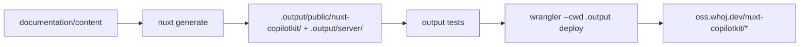

# nuxt-copilotkit — Documentation Site Design Document

**Date:** 2026-10-26
**Status:** Validated (sections approved by maintainer; awaiting spec review)
**Supersedes:** the "deferred post-v1" note in `documentation/README.md`

---

## 1. Overview

Build the public documentation site for `@whoj/nuxt-copilotkit` with [Docus](https://docus.dev), prerendered and served by a Cloudflare Worker at:

```
https://oss.whoj.dev/nuxt-copilotkit/
```

`oss.whoj.dev/<lib>/*` is shared by several independent open-source libraries, each built and deployed separately with its own stack. This site owns only the `/nuxt-copilotkit/*` route.

### Success criteria
- `pnpm docs:generate` produces a prerendered build with no broken internal links.
- Every generated page and asset URL carries the `/nuxt-copilotkit/` prefix.
- `wrangler dev` (local) serves `/nuxt-copilotkit/`, its pages, assets, `llms.txt` and the 404 page correctly.
- Every documented option, default, path and API matches `src/` at the time of writing.
- Module `pnpm lint` and `pnpm test` remain green; docs tooling does not leak into module lint, tests or the published package.

---

## 2. Key Decisions

| # | Decision | Rationale |
|---|---|---|
| S1 | **Docus layer**, `extends: ['docus']` in `documentation/nuxt.config.ts` | Maintainer choice. Docus bundles Nuxt UI, Nuxt Content, search, `nuxt-llms`, sitemap and OG images in one layer, so upgrades are a single `docus` bump. The Nuxt UI Docs Template (`nuxt-ui-templates/docs`) was considered and rejected: same stack, but the whole `app/` would be owned code. |
| S2 | **`documentation/` is a private pnpm workspace package** | Matches `documentation/README.md` and existing convention. Dependencies go through `catalog:dev` because `pnpm-workspace.yaml` sets `catalogMode: strict`. |
| S3 | **`nuxt generate` with the `cloudflare_module` preset**: prerendered pages plus a Worker | Content-only site, so every page is prerendered; Docus prerenders with `crawlLinks: true` in its layer config. The preset places static files under the base URL and generates the Worker config, which replaces a hand-written staging step. On Cloudflare presets Nuxt Content switches to D1 (binding `DB`); whether the prerendered site needs it is verified by the probe (Section 4). |
| S4 | **`app.baseURL: '/nuxt-copilotkit/'`** | The site lives under a shared domain path. |
| S5 | **MCP server disabled** (`mcp.enabled: false`) | The Docus `/mcp` endpoint needs server-side content queries, which this prerendered setup does not provision. `llms.txt` / `llms-full.txt` are prerendered and remain available. Upgrade path: provision D1 and enable it later without changing content. |
| S6 | **Nitro-generated Cloudflare Worker with static assets**; `documentation/wrangler.jsonc` holds only the name, routes (`oss.whoj.dev/nuxt-copilotkit/*` and the bare prefix) and asset handling, merged by Nitro into `.output/server/wrangler.json` | Maintainer's hosting choice. No account id or secrets in the file; wrangler resolves the account from the user's login or environment. |
| S7 | **Manual deploy** via `docs:deploy`; no CI workflow | Maintainer choice. |
| S8 | **Implementation happens in a git worktree** on a feature branch, merged into the working root only after review | Maintainer preference. Worktree lives under the running harness's gitignored folder (for example `.optimus/worktrees/`), per `AGENTS.md`. |
| S9 | **Content is sourced from code**, not the README alone | `src/options.ts` and `src/runtime/**` are the source of truth (see `ARCHITECTURE.md`). Conflicts with README are flagged to the maintainer, not resolved by guessing. |
| S10 | **Mermaid for all diagrams** | Project convention. If Docus does not render Mermaid natively, the maintainer decides between adding a renderer or omitting diagrams. |

---

## 3. Structure

```
documentation/
├── nuxt.config.ts          # extends docus, baseURL, mcp off, llms, site url
├── app/
│   └── app.config.ts       # docus name, description, socials, colors
├── content/                # see Section 5
├── public/                 # favicon, og assets
├── test/                   # Vitest: output checks, HTTP checks against wrangler dev
├── vitest.config.ts        # projects `output` and `worker`
├── wrangler.jsonc          # Worker name, routes, asset handling (merged by Nitro)
├── package.json            # private; scripts dev / generate / preview / test / deploy
└── README.md               # contributor notes for the docs site (replaces stub)
```

Root changes:

- `pnpm-workspace.yaml`: add a `packages:` entry for `documentation`; add `docus` and `wrangler` to `catalog:dev`; `nuxt` reuses the existing `catalog:dev` entry. `better-sqlite3` is added only if the native connector fallback in Section 4 is needed.
- `package.json`: add `docs:dev`, `docs:generate`, `docs:deploy` scripts that delegate to the `documentation` package.
- `.gitignore`: ignore `documentation/.output`, `documentation/.nuxt`, `documentation/.data`, `documentation/.wrangler` (all but `.wrangler` already match existing unanchored entries).
- `vitest.config.ts`: exclude `documentation/**` (`vitest.unit.config.ts` already includes only `test/**/*.unit.test.ts`).
- `eslint.config.mjs`: lint `documentation/nuxt.config.ts` and `documentation/app/**` with the existing config; ignore generated directories (`.nuxt`, `.output`, `.data`, `.wrangler`). If the module's config rules conflict with Docus types, ignore `documentation/**` instead and note it in `documentation/README.md`.
- `package.json` `files` already limits the published package to `dist` and `skills`, so docs never ship to npm.

---

## 4. Build and Deploy



- **Config values:**
  - `app.baseURL`: `/nuxt-copilotkit/`
  - `site.url`: `https://oss.whoj.dev/nuxt-copilotkit`
  - `llms.domain`: `https://oss.whoj.dev/nuxt-copilotkit/`
  - `mcp.enabled`: `false`
- **SQLite:** prefer Nuxt Content's native SQLite connector (Node ≥ 22.5) to avoid a `better-sqlite3` native build and a new `allowBuilds` entry. Fall back to `better-sqlite3` only if the native connector fails with Docus.
- **Base path on Workers Static Assets:** assets are matched against the full request path, so the generated output must sit under a `nuxt-copilotkit/` folder inside the assets directory. The `cloudflare_module` preset writes static files to `.output/public/{{ baseURL }}`, so no staging step is needed.
- **Probe first:** before content work, a throwaway probe confirms (a) asset paths resolve under the prefix, (b) trailing slash and `index.html` handling, (c) the 404 page, and (d) `llms.txt` location, and (e) whether pages, search and navigation work without a D1 binding. If (e) fails, the maintainer chooses between provisioning D1 and reverting to a static build with a staging step. Any change is reported before proceeding.

---

## 5. Content Outline

Mapped from `README.md` sections and `ARCHITECTURE.md`, verified against `src/`.

```
content/
├── index.md                      # Hero + feature grid
├── 1.getting-started/
│   ├── 1.introduction.md         # Why; what the module wires
│   ├── 2.installation.md         # nuxt module add, env key
│   └── 3.first-copilot.md        # <CopilotKit> wrapper + CopilotSidebar
├── 2.guide/
│   ├── 1.frontend-tools.md
│   ├── 2.generative-ui.md        # useCopilotGenUI
│   ├── 3.human-in-the-loop.md    # useCopilotHITL
│   ├── 4.remote-agents.md        # runtime.agents / createRemoteAgent
│   ├── 5.ssr.md                  # SSR boundary
│   └── 6.devtools.md
├── 3.server/
│   ├── 1.built-in-route.md       # /api/_copilotkit, enabled auto-rule
│   ├── 2.hooks.md                # copilotkit:* Nitro hooks
│   └── 3.custom-runtime.md       # defineCopilotRuntime, external runtime url
├── 4.api/
│   ├── 1.configuration.md        # ModuleOptions reference
│   ├── 2.environment.md          # NUXT_COPILOTKIT_* overrides
│   ├── 3.components.md           # registered components, #copilotkit
│   └── 4.composables.md          # composables and server utils
└── 5.community/
    ├── 1.ai-agent-skill.md
    └── 2.contributing.md
```

- The root `README.md` stays; long sections may later link to the site (separate change, not in scope).
- `docs/plans/` is internal and never published.
- Pages follow the public-repository rules in `AGENTS.md`: no secrets, internal URLs, local paths or tooling state.

---

## 6. Verification

| Check | How |
|---|---|
| Build succeeds, no broken links | `pnpm docs:generate`, then the `output` Vitest project (required files, prefixes, internal links). Docus sets `failOnError: false`, so the tests and the log are checked explicitly; `docs:generate` itself does not run them |
| Base path | The `output` tests check every generated `href`/`src` for the `/nuxt-copilotkit/` prefix |
| Worker serving | The `worker` Vitest project (`@nuxt/test-utils`) against `wrangler dev`: `/nuxt-copilotkit/`, the bare prefix redirect, a deep page, an asset, `llms.txt`, and a missing path |
| Content accuracy | Each reference page cross-checked against `src/options.ts` and `src/runtime/**` |
| Module unaffected | `pnpm lint`, `pnpm test` at the repo root |

---

## 7. Out of Scope

- Docus `/mcp` endpoint and server-rendered pages (upgrade path in S5).
- CI deploy workflow.
- i18n.
- Embedding docs in the DevTools tab (parked idea).
- Rewriting the root `README.md`.
