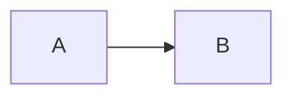
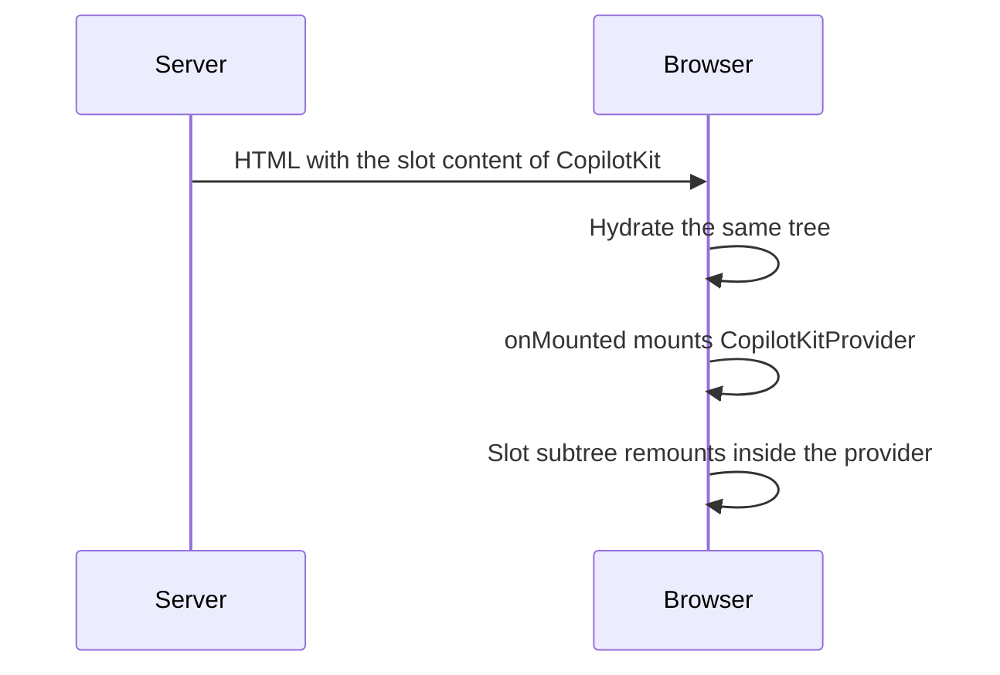
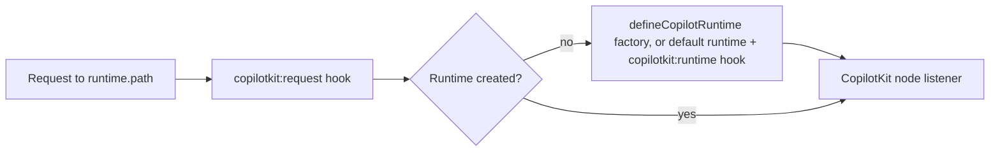

# Documentation Site Implementation Plan

> Execute this plan task by task; steps use checkbox (`- [ ]`) syntax for tracking.

**Goal:** Ship a prerendered Docus site for `@whoj/nuxt-copilotkit`, served by a Cloudflare Worker at `https://oss.whoj.dev/nuxt-copilotkit/`.

**Architecture:** `documentation/` becomes a private pnpm workspace package that extends the `docus` layer. `nuxt generate` runs with Nitro's `cloudflare_module` preset: pages are prerendered into `.output/public/nuxt-copilotkit/` (the preset places static files under the base URL, so Workers Static Assets find them by full request path) and the Worker plus its generated `wrangler.json` go to `.output/server/`. `documentation/wrangler.jsonc` holds only what Nitro cannot infer (name, routes, asset handling). Two Vitest suites in `documentation/test/` check the result: `output.test.ts` (required files, base-path prefix, internal links) and `worker.e2e.test.ts` (HTTP checks with `@nuxt/test-utils` against `wrangler dev`).

**Tech Stack:** Docus 5 (Nuxt UI, Nuxt Content 3, nuxt-llms), Nuxt 4, Nitro `cloudflare_module` preset, Wrangler 4, Vitest + `@nuxt/test-utils`, pnpm 12 workspaces with strict catalogs, Node ≥ 22.5 (`node:sqlite`).

**Spec:** [`docs/plans/2026-10-26-documentation-site-design.md`](./2026-10-26-documentation-site-design.md). Read it before starting; decision IDs (S1–S10) below refer to its Section 2.

## Global Constraints

- Site URL: `https://oss.whoj.dev/nuxt-copilotkit/`; route `oss.whoj.dev/nuxt-copilotkit/*`; the site owns no other path (spec §1).
- `app.baseURL`: `/nuxt-copilotkit/`; `site.url`: `https://oss.whoj.dev/nuxt-copilotkit`; `llms.domain`: `https://oss.whoj.dev/nuxt-copilotkit/`; `mcp.enabled`: `false` (spec §4).
- Docus is used as a layer: `extends: ['docus']` in `documentation/nuxt.config.ts` (S1).
- `documentation/` is a private workspace package; every dependency uses `catalog:dev` (`pnpm-workspace.yaml` sets `catalogMode: strict`) (S2).
- `nuxt generate` with the `cloudflare_module` preset: prerendered pages plus a Worker (S3). Manual deploy via `docs:deploy`; no CI workflow (S7).
- Prefer Nuxt Content's native SQLite connector; add `better-sqlite3` only if native fails with Docus (spec §4).
- No account id, token or secret in `wrangler.jsonc` (S6).
- Work happens in a git worktree under the running harness's gitignored folder (`.optimus/worktrees/` for this plan) on a feature branch; merged only after review (S8, `AGENTS.md`).
- Every script file is TypeScript (`.ts`) using erasable syntax and `node:` builtins only; root config files are the only exception.
- Content is sourced from `src/`; conflicts with `README.md` go to the maintainer, never resolved by guessing (S9).
- Diagrams use Mermaid only; if Docus does not render it, the maintainer decides (S10).
- Module `pnpm lint` and `pnpm test` stay green; docs never enter the published package (`package.json` `files` is `dist`, `skills`) (spec §1, §3).
- `AGENTS.md` public-repository rules apply to every tracked file and commit: no secrets, internal URLs, absolute local paths, usernames, tooling state, or attribution lines.
- Code style: single quotes, semicolons, no trailing commas (`eslint.config.mjs`); extensionless TS imports; new files get a short file-level header comment.
- Commits: conventional style (`feat:`, `docs:`, `chore:`), no task or phase numbers in messages. The maintainer signs and makes the commits: the implementer stages and hands over the exact `git commit` command.

## Decisions made in this plan (beyond the spec)

| # | Decision | Source |
|---|---|---|
| P1 | The probe is the real scaffold with two pages (Tasks 1–2) plus Checkpoint A, not a separate throwaway app. It answers the same four questions (spec §4) without duplicate config. | spec §4 "Probe first" |
| P2 | `.gitignore` gains only `.wrangler`. `dist` (`.gitignore:17`), `.nuxt` (`:20`), `.output` (`:21`) and `.data/` (`:66`) are unanchored and already match inside `documentation/`. | spec §3 |
| P3 | ESLint: add `'documentation'` to `dirs.root` only. `createConfigForNuxt` already applies `.gitignore` and ignores `**/dist`, `**/.nuxt`, `**/.output`, `**/public` (`node_modules/@nuxt/eslint-config/dist/shared/eslint-config.*.mjs`, `ignores()` and `gitignore({ strict: false })`). | spec §3 |
| P4 | Only `vitest.config.ts` gains a `documentation/**` exclude (plus the harness folders). `vitest.unit.config.ts` already restricts `include` to `test/**/*.unit.test.ts`, so it cannot discover docs files. The docs package has its own `vitest.config.ts`. | spec §3 |
| P5 | `docs:generate` only generates. The output checks live in `documentation/test/output.test.ts` (Vitest project `output`) and gate `deploy`, because Docus prerenders with `failOnError: false` and broken links would otherwise pass silently. | spec §6 |
| P6 | Package name `nuxt-copilotkit-docs`, matching `nuxt-copilotkit-playground` / `nuxt-copilotkit-client`. | `playground/package.json`, `client/package.json` |
| P7 | Docus GitHub links point at `who-jonson/nuxt-copilotkit`, branch `dev`, `rootDir: 'documentation'` (set explicitly because in a worktree `.git` is a file). | `package.json` `repository`; `git branch -a` shows `origin/HEAD -> origin/dev` |
| P8 | Nitro's `cloudflare_module` preset replaces a hand-written staging script: it writes static files to `.output/public/{{ baseURL }}`, merges `documentation/wrangler.jsonc` into `.output/server/wrangler.json` and points `.wrangler/deploy/config.json` at it. Preview and deploy use the preset's own commands, `wrangler --cwd .output dev` / `deploy`. | `nitropack/dist/presets/cloudflare/preset.mjs` (`cloudflareModule`), `utils.mjs` (`writeWranglerConfig`) |
| P9 | On a Cloudflare preset Nuxt Content switches to a D1 database with binding `DB`. Whether the prerendered site works without one is a Checkpoint A gate, not an assumption. | `@nuxt/content/dist/module.mjs` (cloudflare preset: "switching to D1 database with binding `DB`") |

Versions found on the npm registry on 2026-10-26: `docus@5.15.0` (peers `nuxt: 4.x`, `better-sqlite3: 12.x`; depends on `@nuxt/content ^3.16.1`), `wrangler@4.152.0`. Already in `catalog:dev`: `@nuxt/test-utils`, `vitest`.

## File Structure

| Path | Responsibility |
|---|---|
| `pnpm-workspace.yaml` (modify) | Add `packages: [documentation]`; `docus`, `wrangler` in `catalog:dev`; `allowBuilds` decisions for new deps |
| `package.json` (modify) | Root `docs:dev`, `docs:generate`, `docs:deploy` delegating scripts |
| `.gitignore` (modify) | Ignore `.wrangler` |
| `eslint.config.mjs` (modify) | Lint `documentation` as a Nuxt root |
| `vitest.config.ts` (modify) | Exclude `documentation/**` and the harness folders |
| `documentation/package.json` | Private package; scripts `dev`, `generate`, `preview`, `test`, `test:output`, `deploy` |
| `documentation/nuxt.config.ts` | Docus layer, base URL, site, native SQLite, Cloudflare preset, typescript, llms, mcp off |
| `documentation/app/app.config.ts` | Branding, socials, GitHub links, colors |
| `documentation/vitest.config.ts` | Vitest projects `output` and `worker` |
| `documentation/test/output.test.ts` | Post-generate checks on `.output/public/nuxt-copilotkit` |
| `documentation/test/worker.e2e.test.ts` | HTTP checks with `@nuxt/test-utils` against `wrangler dev` or `DOCS_URL` |
| `documentation/test/wrangler.global.ts` | Vitest global setup: starts and stops `wrangler dev` |
| `documentation/wrangler.jsonc` | Worker name, routes and asset handling; merged by Nitro |
| `documentation/public/favicon.svg` | Site icon |
| `documentation/content/**` | Pages (spec §5) |
| `documentation/README.md` (rewrite) | Contributor notes for the docs site |

---

## Before you start: worktree

- [ ] **Step 1: Make sure the spec and this plan are committed on `dev`**

A worktree created from `dev` only contains committed files. Confirm both are there:

```bash
git log --oneline -1 -- docs/plans/2026-10-26-documentation-site-design.md docs/plans/2026-10-26-documentation-site-implementation-plan.md
```

Expected: one commit. If nothing prints, ask the maintainer to commit them first.

- [ ] **Step 2: Create a fresh worktree**

Worktrees live in the running harness's gitignored folder, at `.<harness>/worktrees/<name>` (see `AGENTS.md`). This plan uses `.optimus/`:

```bash
git check-ignore -q .optimus/worktrees && echo ignored
git worktree add .optimus/worktrees/docs-site -b feat/docs-site dev
cd .optimus/worktrees/docs-site
mkdir -p .optimus
pnpm install
pnpm dev:prepare
```

Expected: `ignored`, then install and prepare succeed. All later paths are relative to `.optimus/worktrees/docs-site`. Logs and scratch files go in that worktree's own `.optimus/` folder, which `mkdir` creates because a fresh worktree has none.

- [ ] **Step 3: Record the baseline**

```bash
pnpm lint && pnpm test
git status --short
```

Expected: lint clean, tests pass. Run `git checkout-index -f .nuxtrc` if `git status` shows `.nuxtrc` modified (test runs rewrite it).

---

### Task 1: Workspace package, Docus scaffold and output test

**Files:**
- Modify: `pnpm-workspace.yaml`, `package.json`, `.gitignore`, `eslint.config.mjs`, `vitest.config.ts`
- Create: `documentation/package.json`, `documentation/vitest.config.ts`, `documentation/nuxt.config.ts`, `documentation/app/app.config.ts`, `documentation/public/favicon.svg`, `documentation/content/index.md`, `documentation/content/1.getting-started/.navigation.yml`, `documentation/content/1.getting-started/1.introduction.md`
- Test: `documentation/test/output.test.ts`

**Interfaces:**
- Consumes: nothing.
- Produces: package `nuxt-copilotkit-docs` with scripts `generate` (= `nuxt generate`), `test`, `test:output` (= `vitest run --project output`); root script `docs:generate`; static output in `documentation/.output/public/nuxt-copilotkit`. `output.test.ts` derives the expected routes from `content/**/*.md` (numeric prefixes and `index` stripped), so later tasks get page-existence checks for free; each failing test lists every problem in its assertion diff.

- [ ] **Step 1: Wire the workspace**

In `pnpm-workspace.yaml`, add at the top:

```yaml
packages:
  - documentation
```

and add to `catalogs.dev` (keep keys alphabetical):

```yaml
    docus: ^5.15.0
    wrangler: ^4.152.0
```

In root `package.json` `scripts`, add after `"dev:prepare"`:

```json
    "docs:dev": "pnpm --filter nuxt-copilotkit-docs run dev",
    "docs:generate": "pnpm --filter nuxt-copilotkit-docs run generate",
    "docs:deploy": "pnpm --filter nuxt-copilotkit-docs run deploy",
```

`run` is required: without it, `pnpm --filter <pkg> deploy` invokes pnpm's built-in `deploy` command instead of the package script.

Append to `.gitignore` under `# Nuxt`, after `.netlify`:

```
.wrangler
```

This also covers `documentation/.wrangler/deploy/config.json`, which the preset writes on every build.

In `eslint.config.mjs`, extend `dirs.root`:

```js
    root: [
      '',
      'playground',
      'client',
      'documentation'
    ]
```

In `vitest.config.ts`, extend the exclude list so neither the docs package nor any harness folder (worktrees included) is discovered:

```ts
    exclude: [...configDefaults.exclude, '.pi/**', '.optimus/**', '.claude/**', '.agents/**', '.pnpm-store/**', 'documentation/**', '**/*.unit.test.ts']
```

- [ ] **Step 2: Create the package and its test config**

`documentation/package.json` (the `preview` and `deploy` scripts are used in Task 2; adding them now keeps the file in one place):

```json
{
  "private": true,
  "name": "nuxt-copilotkit-docs",
  "type": "module",
  "scripts": {
    "dev": "nuxt dev",
    "generate": "nuxt generate",
    "preview": "wrangler --cwd .output dev",
    "test": "vitest run",
    "test:output": "vitest run --project output",
    "deploy": "nuxt generate && vitest run --project output && wrangler --cwd .output deploy"
  },
  "devDependencies": {
    "@nuxt/test-utils": "catalog:dev",
    "docus": "catalog:dev",
    "nuxt": "catalog:dev",
    "vitest": "catalog:dev",
    "wrangler": "catalog:dev"
  }
}
```

`documentation/vitest.config.ts`:

```ts
// Vitest config for the docs site: `output` checks the generated files, `worker` checks HTTP behaviour.
import { defineConfig } from 'vitest/config';

export default defineConfig({
  test: {
    projects: [
      {
        test: {
          name: 'output',
          include: ['test/output.test.ts']
        }
      },
      {
        test: {
          name: 'worker',
          include: ['test/worker.e2e.test.ts'],
          // Starts `wrangler dev` unless DOCS_URL points at a running site.
          globalSetup: ['test/wrangler.global.ts'],
          hookTimeout: 120_000
        }
      }
    ]
  }
});
```

Run: `pnpm install`
Expected: success; `pnpm-lock.yaml` gains a `documentation` importer.

If pnpm writes new `allowBuilds` entries with the value `set this to true or false`, set each new one to `false`, run `pnpm install` again, and record the package names for Checkpoint A. Leave the existing `inotify` entry alone.

- [ ] **Step 3: Write the output test**

Create `documentation/test/output.test.ts`:

```ts
// Post-generate checks for the docs site. Docus prerenders with failOnError: false,
// so broken links and unprefixed URLs would otherwise pass silently.
import { existsSync, readdirSync, readFileSync, statSync } from 'node:fs';
import { join, relative, sep } from 'node:path';
import { fileURLToPath } from 'node:url';
import { beforeAll, describe, expect, it } from 'vitest';

const ORIGIN = 'https://oss.whoj.dev';
const BASE = '/nuxt-copilotkit/';
const SITE = `${ORIGIN}${BASE}`;
const root = fileURLToPath(new URL('..', import.meta.url));
// The cloudflare_module preset writes static files to .output/public/{{ baseURL }}.
const outDir = join(root, '.output', 'public', 'nuxt-copilotkit');
const contentDir = join(root, 'content');

/** Lists every file below `dir`, recursively. */
function walk(dir: string): string[] {
  return readdirSync(dir).flatMap((name) => {
    const path = join(dir, name);
    return statSync(path).isDirectory() ? walk(path) : [path];
  });
}

/** True when a path below BASE maps to a generated file; a directory alone does not count. */
function routeExists(path: string): boolean {
  const clean = decodeURIComponent(path.replace(/[?#].*$/, '')).replace(/\/$/, '');
  const candidates = clean === '' ? ['index.html'] : [clean, `${clean}.html`, `${clean}/index.html`];
  return candidates.some((candidate) => {
    const file = join(outDir, candidate);
    return existsSync(file) && statSync(file).isFile();
  });
}

/** Returns a problem for one same-site URL, or `undefined` when it is fine or points elsewhere. */
function checkUrl(raw: string): string | undefined {
  const url = raw.startsWith(`${ORIGIN}/`) ? raw.slice(ORIGIN.length) : raw;
  if (!url.startsWith('/') || url.startsWith('//')) {
    return undefined;
  }
  // The bare prefix is the home link; the Worker redirects it to BASE.
  if (url === BASE.slice(0, -1)) {
    return undefined;
  }
  if (!url.startsWith(BASE)) {
    return `unprefixed URL ${raw}`;
  }
  return routeExists(url.slice(BASE.length)) ? undefined : `broken link ${raw}`;
}

beforeAll(() => {
  if (!existsSync(outDir)) {
    throw new Error(`Missing ${relative(root, outDir)}; run \`pnpm docs:generate\` first.`);
  }
});

describe('generated output', () => {
  it('contains the required files', () => {
    const missing = ['index.html', '404.html', 'llms.txt', 'llms-full.txt'].filter(file => !existsSync(join(outDir, file)));
    expect(missing).toEqual([]);
  });

  it('references the site in llms.txt', () => {
    expect(readFileSync(join(outDir, 'llms.txt'), 'utf8')).toContain(SITE);
  });

  it('has a page for every content file', () => {
    const missing = walk(contentDir)
      .filter(file => file.endsWith('.md'))
      .map(md => relative(contentDir, md)
        .replace(/\.md$/, '')
        .split(sep)
        .map(segment => segment.replace(/^\d+\./, ''))
        .join('/')
        .replace(/(?:^|\/)index$/, ''))
      .filter(route => !routeExists(route));
    expect(missing).toEqual([]);
  });

  it('prefixes and resolves every internal link', () => {
    const urlAttribute = /\s(?:href|src)=(["'])(.*?)\1/g;
    const problems = new Set<string>();

    for (const html of walk(outDir).filter(file => file.endsWith('.html'))) {
      for (const [, , url] of readFileSync(html, 'utf8').matchAll(urlAttribute)) {
        const problem = checkUrl(url);
        if (problem) {
          problems.add(`${relative(outDir, html)}: ${problem}`);
        }
      }
    }

    expect([...problems]).toEqual([]);
  });

  // Report only: whether llms*.txt links should resolve is decided at Checkpoint A (contentRawMarkdown).
  it('reports unresolved links in llms.txt and llms-full.txt', () => {
    const markdownLink = /\]\((https:\/\/oss\.whoj\.dev\/[^)\s]*)\)/g;
    for (const file of ['llms.txt', 'llms-full.txt']) {
      const unresolved = [...readFileSync(join(outDir, file), 'utf8').matchAll(markdownLink)]
        .map(([, url]) => url)
        .filter(url => checkUrl(url) !== undefined);
      if (unresolved.length > 0) {
        console.warn(`${file}: ${unresolved.length} unresolved link(s), e.g. ${unresolved.slice(0, 5).join(', ')}`);
      }
    }
  });
});
```

- [ ] **Step 4: Run it to verify it fails**

Run: `pnpm --filter nuxt-copilotkit-docs run test:output`
Expected: every test fails with `Missing .output/public/nuxt-copilotkit; run \`pnpm docs:generate\` first.`

- [ ] **Step 5: Create the site config**

`documentation/nuxt.config.ts` (keys in the order `nuxt/nuxt-config-keys-order` expects; replace the `compatibilityDate` value with the day you scaffold, which must be on or after `2024-09-19`):

```ts
// Docus site for @whoj/nuxt-copilotkit: prerendered and served by a Cloudflare Worker under oss.whoj.dev/nuxt-copilotkit/.
export default defineNuxtConfig({
  extends: ['docus'],

  app: {
    // The domain is shared by several libraries; this site owns only this prefix.
    baseURL: '/nuxt-copilotkit/'
  },

  site: {
    name: 'nuxt-copilotkit',
    url: 'https://oss.whoj.dev/nuxt-copilotkit'
  },

  content: {
    // node:sqlite (Node >= 22.5) avoids a better-sqlite3 native build.
    experimental: { sqliteConnector: 'native' }
  },

  experimental: {
    // Writes 404.html so a static not-found page exists.
    prerenderErrorPages: true
  },

  // Pinned, not 'latest': the preset copies it into the generated wrangler.json.
  compatibilityDate: '2026-10-26',

  nitro: {
    preset: 'cloudflare_module',
    cloudflare: {
      // Generate .output/server/wrangler.json from documentation/wrangler.jsonc.
      deployConfig: true,
      nodeCompat: true
    },
    prerender: {
      // Write route.html instead of route/index.html so slash-less links are served without a redirect.
      autoSubfolderIndex: false
    }
  },

  typescript: {
    // The root .nuxtrc turns these on for the module; the docs site must not inherit them.
    includeWorkspace: false,
    typeCheck: false
  },

  llms: {
    domain: 'https://oss.whoj.dev/nuxt-copilotkit/',
    title: 'nuxt-copilotkit',
    description: 'SSR-safe CopilotKit integration for Nuxt: built-in Nitro runtime route, generative UI and human-in-the-loop helpers, remote AG-UI agents and a DevTools tab.',
    full: {
      title: 'nuxt-copilotkit',
      description: 'Complete nuxt-copilotkit documentation: installation, guides, server runtime and API reference.'
    }
  },

  // Kept off: the site is prerendered and exposes no MCP endpoint (spec §4).
  mcp: {
    enabled: false
  }
});
```

Do not add a `documentation/tsconfig.json`: `AGENTS.md` forbids hand-written tsconfig files, and the build does not need one.

`documentation/app/app.config.ts`:

```ts
// Docus app config: branding, repository links and theme colors for the nuxt-copilotkit docs.
export default defineAppConfig({
  seo: {
    title: 'nuxt-copilotkit',
    description: 'AI copilots, generative UI and agents for Nuxt — SSR-safe, zero-boilerplate, powered by CopilotKit.'
  },
  header: {
    title: 'nuxt-copilotkit'
  },
  socials: {
    npm: 'https://npmjs.com/package/@whoj/nuxt-copilotkit'
  },
  github: {
    url: 'https://github.com/who-jonson/nuxt-copilotkit',
    branch: 'dev',
    rootDir: 'documentation'
  },
  ui: {
    colors: {
      // Nuxt green, matching the README badges (colorB=00DC82).
      primary: 'green',
      neutral: 'zinc'
    }
  }
});
```

`documentation/public/favicon.svg`:

```svg
<svg xmlns="http://www.w3.org/2000/svg" viewBox="0 0 32 32"><rect width="32" height="32" rx="6" fill="#020420"/><path d="M9 21l7-12 7 12z" fill="#00DC82"/></svg>
```

- [ ] **Step 6: Add the first two pages**

`documentation/content/index.md`:

````markdown
---
seo:
  title: nuxt-copilotkit
  description: AI copilots, generative UI and agents for Nuxt — SSR-safe, zero-boilerplate, powered by CopilotKit.
---

::u-page-hero
#title
nuxt-copilotkit

#description
AI copilots, generative UI and agents for Nuxt — SSR-safe, zero-boilerplate, powered by [CopilotKit](https://copilotkit.ai).

#links
  :::u-button
  ---
  color: neutral
  size: xl
  to: /getting-started/introduction
  trailing-icon: i-lucide-arrow-right
  ---
  Get started
  :::

  :::u-button
  ---
  color: neutral
  icon: i-simple-icons-github
  size: xl
  to: https://github.com/who-jonson/nuxt-copilotkit
  target: _blank
  variant: outline
  ---
  View on GitHub
  :::
::

::u-page-section
#title
What the module does

#features
  :::u-page-feature
  ---
  icon: i-lucide-zap
  ---
  #title
  Built-in runtime route

  #description
  A Nitro handler at `/api/_copilotkit`, created lazily on the first request.
  :::

  :::u-page-feature
  ---
  icon: i-lucide-shield-check
  ---
  #title
  SSR-safe

  #description
  The `<CopilotKit>` wrapper renders its slot on the server; browser-only code never runs during SSR.
  :::

  :::u-page-feature
  ---
  icon: i-lucide-puzzle
  ---
  #title
  Auto-registered

  #description
  Every upstream `@copilotkit/vue` component and composable, auto-imported and available from `#copilotkit`.
  :::

  :::u-page-feature
  ---
  icon: i-lucide-palette
  ---
  #title
  Generative UI and human in the loop

  #description
  `useCopilotGenUI` and `useCopilotHITL`, with components resolvable by name.
  :::

  :::u-page-feature
  ---
  icon: i-lucide-bot
  ---
  #title
  Bring any agent

  #description
  Register remote AG-UI agents (LangGraph, Google ADK, Claude Agent SDK, VoltAgent, A2A bridges) by URL.
  :::

  :::u-page-feature
  ---
  icon: i-lucide-lock
  ---
  #title
  Secrets stay server-side

  #description
  API keys and agent headers live in private `runtimeConfig`.
  :::
::
````

`documentation/content/1.getting-started/.navigation.yml`:

```yaml
title: Getting Started
icon: i-lucide-rocket
```

`documentation/content/1.getting-started/1.introduction.md`:

````markdown
---
title: Introduction
description: What nuxt-copilotkit wires into a Nuxt app, and why.
navigation:
  icon: i-lucide-info
---

[`@copilotkit/vue`](https://docs.copilotkit.ai) gives you chat UIs, frontend tools and generative UI; [`@copilotkit/runtime`](https://docs.copilotkit.ai) talks to models and [AG-UI](https://docs.ag-ui.com) agents. Wiring both into Nuxt by hand means a server route, a provider that must not run during SSR, component registration, and secrets that must stay on the server.

`nuxt-copilotkit` does that wiring for you: one module, configured from `nuxt.config`, with runtime config and environment overrides.

## What the module sets up

- **A server route.** A Nitro handler at `/api/_copilotkit` (and `/api/_copilotkit/**`) that builds a CopilotKit runtime on the first request.
- **An SSR-safe wrapper.** `<CopilotKit>` renders its slot on the server and mounts the live provider after hydration.
- **Components and composables.** The 30 upstream `@copilotkit/vue` components are registered client-only, and the upstream composables plus the module's helpers are auto-imported.
- **Generative UI helpers.** `useCopilotGenUI` and `useCopilotHITL` resolve components by name and do nothing during SSR.
- **Server extension points.** Typed `copilotkit:*` Nitro hooks and `defineCopilotRuntime` for full control.
- **Private configuration.** Model keys and agent headers live in private `runtimeConfig`; the client only sees the runtime URL and the debug flag.
- **A DevTools tab.** Inspect the runtime mode, resolved configuration and API key status.

## Requirements

- Nuxt `>=4.6.0`.
- `@copilotkit/vue` (required peer).
- `@copilotkit/runtime` (optional peer, needed only for the built-in route).

::note
Version 1 is in active development. Expect rough edges until the first stable release.
::
````

- [ ] **Step 7: Prepare and record the type-check result**

```bash
pnpm exec nuxi prepare documentation
pnpm test:types 2>&1 | tail -30
```

Expected: prepare succeeds. Record the `test:types` result for Checkpoint A without changing any config: preparing the docs app may add its types to the module's check, or it may introduce errors from the docs package. Restore `.nuxtrc` with `git checkout-index -f .nuxtrc` if it changed.

- [ ] **Step 8: Generate and run the output test**

```bash
pnpm docs:generate 2>&1 | tee .optimus/docs-generate.log
pnpm --filter nuxt-copilotkit-docs run test:output
```

Expected: `nuxt generate` finishes; all tests in project `output` pass.

If generation fails because the native SQLite connector does not work with Docus, stop and record the error for Checkpoint A (the fallback, `better-sqlite3`, needs an `allowBuilds: true` entry and a maintainer decision). If a test fails, record the problems it lists; do not paper over them by loosening the test. Record what the `llms*.txt` report test printed.

Also run: `grep -iE "error|warn|D1" .optimus/docs-generate.log | head -50` and keep the output for Checkpoint A. A warning that Nuxt Content is "switching to D1 database with binding `DB`" is expected on this preset (P9); it is assessed in Task 2.

- [ ] **Step 9: Confirm the app.config keys against the installed layer**

Run: `ls documentation/node_modules/docus/app/ && grep -nE "seo|header|socials|github|toc" documentation/node_modules/docus/app/app.config.ts`
Expected: the layer's defaults use the top-level keys from Step 5 (`seo`, `header`, `socials`, `github`). If it nests them differently (for example under a `docus:` key), adjust `app.config.ts` to match and record the change for Checkpoint A.

- [ ] **Step 10: Lint and module tests**

Run: `pnpm lint:fix && pnpm lint && pnpm test`
Expected: lint clean, tests pass, no test discovered under `documentation/`. Restore `.nuxtrc` with `git checkout-index -f .nuxtrc` if it changed.

- [ ] **Step 11: Stage and hand over the commit**

```bash
git add pnpm-workspace.yaml pnpm-lock.yaml package.json .gitignore eslint.config.mjs vitest.config.ts documentation/package.json documentation/vitest.config.ts documentation/nuxt.config.ts documentation/app documentation/public documentation/test/output.test.ts documentation/content
git diff --cached --stat
```

Maintainer commits: `git commit -m "feat(docs): scaffold Docus documentation site"`

---

### Task 2: Worker config and HTTP tests

**Files:**
- Create: `documentation/wrangler.jsonc`, `documentation/test/wrangler.global.ts`
- Test: `documentation/test/worker.e2e.test.ts`

**Interfaces:**
- Consumes: `documentation/.output` from Task 1; scripts `preview`, `test`, `deploy` and Vitest project `worker`, already declared in Task 1.
- Produces: `.output/server/wrangler.json` generated from `wrangler.jsonc`; Vitest project `worker`, which runs against `DOCS_URL` when set and otherwise starts `wrangler dev` on port 8787 itself.

- [ ] **Step 1: Write the HTTP test**

Create `documentation/test/worker.e2e.test.ts`:

```ts
// HTTP checks for the generated Worker, against `wrangler dev` (see wrangler.global.ts) or DOCS_URL.
import { fetch, setup } from '@nuxt/test-utils/e2e';
import { describe, expect, it } from 'vitest';

const BASE = '/nuxt-copilotkit/';
const SITE = 'https://oss.whoj.dev/nuxt-copilotkit/';
const host = process.env.DOCS_URL ?? 'http://localhost:8787';

/** Fetches a path without following redirects, so redirect behaviour is asserted explicitly. */
function get(path: string) {
  return fetch(path, { redirect: 'manual' });
}

describe('docs worker', async () => {
  // `host` skips the build and server steps; an empty `fixture` skips loading a Nuxt app.
  await setup({ host, fixture: '' });

  it('serves the home page and its assets', async () => {
    const home = await get(BASE);
    expect(home.status).toBe(200);

    const asset = (await home.text()).match(/\/nuxt-copilotkit\/_nuxt\/[^"']+\.js/)?.[0];
    expect(asset).toBeDefined();
    expect((await get(asset!)).status).toBe(200);
  });

  it('redirects the bare prefix to the base URL', async () => {
    const bare = await get('/nuxt-copilotkit');
    expect(bare.status).toBeGreaterThanOrEqual(300);
    expect(bare.status).toBeLessThan(400);

    const location = new URL(bare.headers.get('location') ?? '', host);
    expect(`${location.pathname}${location.search}`).toBe(BASE);
  });

  it('serves a deep page without a redirect', async () => {
    expect((await get(`${BASE}getting-started/introduction`)).status).toBe(200);
  });

  it('serves llms.txt with the site domain', async () => {
    const llms = await get(`${BASE}llms.txt`);
    expect(llms.status).toBe(200);
    expect(await llms.text()).toContain(SITE);
  });

  it('answers unknown paths with the generated 404 page', async () => {
    const missing = await get(`${BASE}this-page-does-not-exist`);
    expect(missing.status).toBe(404);
    expect(await missing.text()).toContain('/nuxt-copilotkit/_nuxt/');
  });
});
```

Create `documentation/test/wrangler.global.ts`:

```ts
// Vitest global setup for the `worker` project: serves the generated Worker with `wrangler dev`
// unless DOCS_URL points at a site that is already running.
import { spawn } from 'node:child_process';
import { join } from 'node:path';
import { fileURLToPath } from 'node:url';

const PORT = 8787;
const READY_TIMEOUT_MS = 60_000;

/** Starts `wrangler --cwd .output dev` and resolves once the base URL answers; returns the teardown. */
export default async function setup(): Promise<(() => void) | undefined> {
  if (process.env.DOCS_URL) {
    return undefined;
  }

  const root = fileURLToPath(new URL('..', import.meta.url));
  const child = spawn(join(root, 'node_modules', '.bin', 'wrangler'), ['--cwd', '.output', 'dev', '--port', String(PORT)], {
    cwd: root,
    stdio: ['ignore', 'inherit', 'inherit']
  });
  const ready = `http://localhost:${PORT}/nuxt-copilotkit/`;
  const deadline = Date.now() + READY_TIMEOUT_MS;

  while (Date.now() < deadline) {
    if (child.exitCode !== null) {
      throw new Error(`wrangler dev exited with code ${child.exitCode}; run \`pnpm docs:generate\` first.`);
    }
    try {
      await fetch(ready);
      return () => {
        child.kill();
      };
    }
    catch {
      await new Promise(resolve => setTimeout(resolve, 500));
    }
  }

  child.kill();
  throw new Error(`wrangler dev did not answer on ${ready} within ${READY_TIMEOUT_MS / 1000} s`);
}
```

- [ ] **Step 2: Run it to verify it fails**

Run: `DOCS_URL=http://localhost:8787 pnpm --filter nuxt-copilotkit-docs exec vitest run --project worker`
Expected: every test fails with a connection error (`ECONNREFUSED` / `fetch failed`): `DOCS_URL` skips the global setup and nothing is serving yet.

- [ ] **Step 3: Write the Worker config**

Create `documentation/wrangler.jsonc`:

```jsonc
// Worker settings Nitro cannot infer. The cloudflare_module preset merges this file into
// .output/server/wrangler.json and adds main, the assets directory and binding, and the
// compatibility date. The account comes from `wrangler login` or CLOUDFLARE_ACCOUNT_ID;
// nothing secret belongs in this file.
{
  "$schema": "./node_modules/wrangler/config-schema.json",
  "name": "nuxt-copilotkit-docs",
  "assets": {
    "html_handling": "auto-trailing-slash",
    "not_found_handling": "404-page"
  },
  "routes": [
    // The bare prefix is listed too so /nuxt-copilotkit reaches the Worker and redirects to /nuxt-copilotkit/.
    { "pattern": "oss.whoj.dev/nuxt-copilotkit", "zone_name": "whoj.dev" },
    { "pattern": "oss.whoj.dev/nuxt-copilotkit/*", "zone_name": "whoj.dev" }
  ]
}
```

- [ ] **Step 4: Regenerate and inspect the generated config**

```bash
pnpm docs:generate 2>&1 | tee .optimus/docs-generate.log
cat documentation/.output/server/wrangler.json
cat documentation/.wrangler/deploy/config.json
ls documentation/.output/public/nuxt-copilotkit/getting-started/
```

Expected:
- `wrangler.json` has `name` and both `routes` from `wrangler.jsonc`; `main` pointing at `index.mjs`; `assets` with `binding: "ASSETS"`, a `directory` resolving to `.output/public`, and the two handling keys; the pinned `compatibility_date`; `compatibility_flags` from `nodeCompat`. Record `compatibility_date` and `compatibility_flags` for Checkpoint A.
- `config.json` points at `../../.output/server/wrangler.json`.
- `getting-started/` contains `introduction.html`, not `introduction/index.html` (`autoSubfolderIndex: false`).
- No `[cloudflare] Wrangler config ... is overridden` warning in the log. If one appears, record it.

- [ ] **Step 5: Run the HTTP tests**

Run: `pnpm --filter nuxt-copilotkit-docs exec vitest run --project worker`
Expected: the global setup starts `wrangler dev` on port 8787 (it does not apply `routes` locally) and all tests pass.

Record for Checkpoint A, and do not patch around any failure:
- Which config `wrangler dev` reports using. If it picked `documentation/wrangler.jsonc` instead of the generated `.output/server/wrangler.json`, record it.
- Deep page: anything other than `200` (for example a `307` to a trailing slash).
- 404 and content pages: whether they work without a `DB` binding (P9). Unknown paths fall through to the Worker, so the 404 result shows how the Worker behaves without D1.

To check by hand as well, run `pnpm --filter nuxt-copilotkit-docs run preview` and open `http://localhost:8787/nuxt-copilotkit/`: use the search, follow two sidebar links, and open an unknown path. Record what works.

- [ ] **Step 6: Check Mermaid support (for S10)**

Run: `grep -rli mermaid documentation/node_modules/docus/ documentation/node_modules/@nuxtjs/mdc/dist 2>/dev/null | head`

`@nuxtjs/mdc` may not be linked under `documentation/node_modules` (the workspace hoists dependencies). If the second path does not exist, find where the package resolves, run the grep there and correct the path in this step.

Then add a temporary block to `documentation/content/1.getting-started/1.introduction.md`:

````markdown

````

Regenerate, run `pnpm --filter nuxt-copilotkit-docs run preview`, open `http://localhost:8787/nuxt-copilotkit/getting-started/introduction` in a browser and note whether a diagram or a plain code block renders. Remove the temporary block afterwards and confirm `git diff documentation/content` is empty.

- [ ] **Step 7: Lint**

Run: `pnpm lint:fix && pnpm lint`
Expected: clean.

- [ ] **Step 8: Stage and hand over the commit**

```bash
git add documentation/wrangler.jsonc documentation/test/worker.e2e.test.ts documentation/test/wrangler.global.ts
git diff --cached --stat
```

Maintainer commits: `git commit -m "feat(docs): serve the site from a Cloudflare Worker"`

---

## Checkpoint A: probe report and content decisions (stop here)

Report to the maintainer and wait for answers before Task 3.

**Probe results** (spec §4):
1. Asset paths under the prefix: the `output` link test and the `worker` asset test.
2. Trailing slash and `.html` files: the Task 2 Step 4 listing and the deep-page test (`autoSubfolderIndex: false` is set from the start).
3. 404 page: the `worker` 404 test.
4. `llms.txt` location: `/nuxt-copilotkit/llms.txt` and its domain. Also report what the `llms*.txt` link test printed; the maintainer decides whether to disable Docus raw Markdown (`contentRawMarkdown`) or leave the default.
5. SQLite: native connector worked, or the error.
6. **D1 gate (P9).** Whether pages, search and sidebar navigation work under `wrangler dev` without a `DB` binding (Task 2 Step 5). If they do not, the maintainer chooses: **provision a D1 database** (binding `DB`) or **revert to a static build plus a staging step** (needs a plan revision). Do not start Task 3 before this is answered.
7. Generated Worker config: `compatibility_date` and `compatibility_flags` in `.output/server/wrangler.json`, any `overridden` warning, and which config `wrangler dev` used.
8. Type check: the `pnpm test:types` result from Task 1 Step 7.
9. New `allowBuilds` entries set to `false`, and whether anything failed because of them.
10. `app.config.ts` key adjustments, if any.
11. Warnings from `.optimus/docs-generate.log` (for example OG image or sitemap issues).
12. Mermaid: rendered or not. If not, ask the maintainer: **add a renderer** (needs a plan revision) or **omit diagrams**. Pages in Tasks 4–5 mark their diagrams with `<!-- mermaid -->`. If diagrams are omitted, delete each marker together with the block below it; if they are kept, delete only the marker line. Tasks 4 and 5 have an explicit step for this.

**Source conflicts** (S9). Each item below is a mismatch between `README.md`/option docs and the code. The pages in this plan describe the code; ask the maintainer to confirm or change each. Each content task has a step that applies the answers:

| # | Conflict | Code | Plan wording |
|---|---|---|---|
| C1 | `provider.inspector` is documented as an option, but nothing reads it. | Only declared: `src/options.ts`, `src/devtools.ts:21`; no use in `src/module.ts` or `src/runtime/**`. | Listed in the reference with "Declared; not wired in this version." |
| C2 | `provider.autoWrap` is documented as "Auto-wrap the app in `<CopilotKitProvider>`", but the plugin only provides module context and logs that it cannot install the provider. | `src/runtime/app/plugin.client.ts:16-27`. | `<CopilotKit>` is required; `autoWrap` provides `useNuxtCopilotKit()` context and the dev hint. |
| C3 | `ARCHITECTURE.md` §3 says the wrapper is registered `mode: 'client'`; the code registers it universal. | `src/module.ts:205-208`. | Wrapper is universal; upstream components are client-only. (`ARCHITECTURE.md` is not changed by this plan.) |
| C4 | README says GenUI/HITL registrations "show up in the DevTools registry"; the Registrations panel is a placeholder. | `client/pages/index.vue:242-258`. | Pages say registrations are recorded in `useState` for DevTools; the panel is not described as working. |
| C5 | `copilotkit:threads` is declared but never called. | Declared in `src/module.ts` type template; no `callHook('copilotkit:threads'` in `src/`. | "Reserved; not called in this version." |

Two further README-vs-code conflicts are known and deliberately not resolved in this plan: the scope of `components.global` (it only applies to the 30 upstream components) and components being "available from `#copilotkit`" (the barrel exports composables and types only). The maintainer tracks them separately. Do not change the affected wording here; when they are fixed, the pages that mention them (`index.md`, `2.guide/2.generative-ui.md`, `4.api/1.configuration.md`) must be updated with the fix.

---

### Task 3: Getting started pages

**Files:**
- Create: `documentation/content/1.getting-started/2.installation.md`, `documentation/content/1.getting-started/3.first-copilot.md`

**Interfaces:**
- Consumes: section `1.getting-started/` with `.navigation.yml` (Task 1); Checkpoint A answer for C2.
- Produces: routes `/getting-started/installation`, `/getting-started/first-copilot`, linked from later pages.

- [ ] **Step 1: Write `2.installation.md`**

````markdown
---
title: Installation
description: Add nuxt-copilotkit to a Nuxt app and configure a model key.
navigation:
  icon: i-lucide-download
---

## Add the module

```bash
npx nuxt module add @whoj/nuxt-copilotkit
```

Your package manager installs the required peer `@copilotkit/vue`.

::note
`@copilotkit/runtime` is an optional peer, needed only for the [built-in route](/server/built-in-route). If it is missing when the route is enabled, the module prints the exact install command.
::

### Manual install

```bash
pnpm add -D @whoj/nuxt-copilotkit
```

```ts [nuxt.config.ts]
export default defineNuxtConfig({
  modules: ['@whoj/nuxt-copilotkit']
})
```

## Add a model key

The built-in route runs `openai/gpt-4o` by default. Put the key in `.env`; it is read into private runtime config and never reaches the client:

```bash [.env]
NUXT_COPILOTKIT_OPENAI_API_KEY=sk-...
```

For Anthropic models, set `NUXT_COPILOTKIT_ANTHROPIC_API_KEY` and a model such as `anthropic/...` in `copilotkit.runtime.model`. See [Environment variables](/api/environment).

## Static and SPA apps

The built-in route needs a live Nitro server. With `ssr: false` or `nuxt generate`, it is off by default and the module logs a warning. Either point the client at a runtime hosted elsewhere ([Custom runtime](/server/custom-runtime)) or set `copilotkit.runtime.enabled: true` if you deploy a server.
````

- [ ] **Step 2: Write `3.first-copilot.md`**

````markdown
---
title: Your first copilot
description: Wrap the app in <CopilotKit> and add a chat sidebar.
navigation:
  icon: i-lucide-message-square
---

## Wrap the app

```vue [app/app.vue]
<template>
  <CopilotKit>
    <NuxtPage />
    <CopilotSidebar />
  </CopilotKit>
</template>
```

`CopilotSidebar` talks to `/api/_copilotkit`, which runs `openai/gpt-4o` by default.

## Why the wrapper is needed

The upstream provider cannot be installed headlessly from a plugin. `<CopilotKit>` reads the runtime URL and debug flag from public runtime config and mounts the upstream `CopilotKitProvider` once the app has hydrated. Any extra attributes are forwarded to the provider.

With `provider.autoWrap: true` (the default), a client plugin provides the module context returned by `useNuxtCopilotKit()` and logs a one-line hint in development pointing at `<CopilotKit>`. Set `provider.autoWrap: false` to drop the plugin and the hint.

## Next steps

- Let the model call browser functions: [Frontend tools](/guide/frontend-tools).
- Render your own components while tools run: [Generative UI](/guide/generative-ui).
- Understand what renders on the server: [SSR](/guide/ssr).
````

- [ ] **Step 3: Verify facts against the source**

Run each and confirm the output supports the page:

```bash
grep -n "nuxt:" src/module.ts                                  # >=4.6.0
grep -n "warnIfMissing('@copilotkit/runtime'" src/module.ts    # runtime peer warning
grep -n "openai/gpt-4o" src/options.ts                         # default model
grep -n "hasServerRuntime =" src/module.ts                     # ssr/static rule
grep -n "console.info" src/runtime/app/plugin.client.ts        # dev hint
grep -n "v-bind=\"\$attrs\"" src/runtime/app/components/CopilotKit.vue
```

Expected: each grep matches. A miss means the page is wrong; fix the page, not the source.

- [ ] **Step 4: Apply the Checkpoint A answers**

C2 → `3.first-copilot.md` ("Why the wrapper is needed"). If the maintainer confirmed the plan wording, leave the page as written; otherwise rewrite that section to the agreed wording.

- [ ] **Step 5: Generate and check**

Run: `pnpm docs:generate && pnpm --filter nuxt-copilotkit-docs run test:output`
Expected: only the internal-link test fails, and every problem it lists is a `broken link` to a `/nuxt-copilotkit/guide/*`, `/nuxt-copilotkit/server/*` or `/nuxt-copilotkit/api/*` page that Tasks 4–6 create. Any other problem (missing page, unprefixed URL, other broken link) must be fixed now.

- [ ] **Step 6: Stage and hand over the commit**

```bash
git add documentation/content/1.getting-started
git diff --cached --stat
```

Maintainer commits: `git commit -m "docs: add installation and first copilot pages"`

---

### Task 4: Guide pages

**Files:**
- Create: `documentation/content/2.guide/.navigation.yml` and `1.frontend-tools.md` … `6.devtools.md` under `documentation/content/2.guide/`

**Interfaces:**
- Consumes: Checkpoint A answers for C3, C4 and Mermaid.
- Produces: routes `/guide/frontend-tools`, `/guide/generative-ui`, `/guide/human-in-the-loop`, `/guide/remote-agents`, `/guide/ssr`, `/guide/devtools`.

- [ ] **Step 1: Write `.navigation.yml`**

```yaml
title: Guide
icon: i-lucide-book-open
```

- [ ] **Step 2: Write `1.frontend-tools.md`**

````markdown
---
title: Frontend tools
description: Let the model call functions that run in the browser.
navigation:
  icon: i-lucide-wrench
---

All upstream `@copilotkit/vue` composables are auto-imported. Register a tool with `useFrontendTool`:

```vue
<script setup lang="ts">
useFrontendTool({
  name: 'sayHello',
  description: 'Say hello to the user',
  handler: async ({ name }: { name: string }) => `Hello, ${name}!`
})
</script>
```

The same composables can be imported explicitly from `#copilotkit`:

```ts
import { useFrontendTool } from '#copilotkit'
```

See [Composables](/api/composables) for the full list, and the [CopilotKit docs](https://docs.copilotkit.ai) for each composable's options.
````

- [ ] **Step 3: Write `2.generative-ui.md`**

````markdown
---
title: Generative UI
description: Render your own components while a tool runs, with useCopilotGenUI.
navigation:
  icon: i-lucide-palette
---

`useCopilotGenUI` wraps the upstream `useRenderTool`. It adds an SSR guard, resolves components by name, and records the registration for DevTools.

```vue
<script setup lang="ts">
import { z } from 'zod'

useCopilotGenUI({
  name: 'showWeather',
  description: 'Show the weather for a city',
  parameters: z.object({ city: z.string() }),
  render: 'WeatherCard' // resolved from components/WeatherCard.vue
})
</script>
```

## Options

| Option | Type | Description |
|---|---|---|
| `name` | `string` | Tool name, or `'*'` for a catch-all renderer. |
| `parameters` | Standard Schema (for example Zod) | Tool arguments. Required unless `name` is `'*'`. |
| `render` | component, render function, or component name | What to render while the tool runs. |
| `agentId` | `string` | Limit the renderer to one agent. |
| `description` | `string` | Shown in the DevTools registration record. |

A second, optional argument takes reactive dependencies; the tool is re-registered when they change.

## Rendering by name

When `render` is a string, it is resolved with `resolveComponent`. That works for globally registered components, which is why `components.global` defaults to `true`. If the name does not resolve, the composable logs `[nuxt-copilotkit] GenUI component "<name>" not found` and registers nothing.

## Catch-all renderer

Use `name: '*'` to render any tool that has no UI of its own:

```ts
useCopilotGenUI({ name: '*', render: 'ToolFallback' })
```

## SSR

The composable returns immediately on the server. Registrations only happen in the browser.
````

- [ ] **Step 4: Write `3.human-in-the-loop.md`**

````markdown
---
title: Human in the loop
description: Pause the agent until the user responds, with useCopilotHITL.
navigation:
  icon: i-lucide-hand
---

`useCopilotHITL` wraps the upstream `useHumanInTheLoop` with the same additions as `useCopilotGenUI`: an SSR guard, by-name component resolution, and a DevTools registration record.

```vue
<script setup lang="ts">
useCopilotHITL({
  name: 'confirmBooking',
  description: 'Ask the user to confirm a booking',
  render: 'ConfirmBooking'
})
</script>
```

`render` accepts a component, a render function, or the name of a globally registered component. All other options are passed to the upstream `useHumanInTheLoop`; see the [CopilotKit docs](https://docs.copilotkit.ai) for the props your component receives and how it responds.

If a component name does not resolve, the composable logs `[nuxt-copilotkit] HITL component "<name>" not found` and registers nothing. On the server it does nothing.
````

- [ ] **Step 5: Write `4.remote-agents.md`**

````markdown
---
title: Remote agents
description: Register AG-UI agents by URL with runtime.agents or createRemoteAgent.
navigation:
  icon: i-lucide-bot
---

Any backend that speaks [AG-UI](https://docs.ag-ui.com) over HTTP can be registered by URL: LangGraph, Google ADK, Claude Agent SDK, VoltAgent, A2A bridges and others.

## Static agents

```ts [nuxt.config.ts]
export default defineNuxtConfig({
  copilotkit: {
    runtime: {
      agents: {
        default: {
          url: 'http://localhost:8000/agent',
          headers: { Authorization: `Bearer ${process.env.AGENT_TOKEN}` }
        }
      }
    }
  }
})
```

Each entry takes `url`, optional `headers` and an optional `description`. The entries are copied into private runtime config, so headers never reach the client.

When `agents` has at least one entry, it **replaces** the default built-in agent, and Nuxt needs no model key. Register the id the client uses: `default`, unless a component selects another agent with its `agent-id` prop.

## Dynamic agents

Use `createRemoteAgent` from a Nitro plugin when the list depends on runtime values:

```ts [server/plugins/copilotkit.ts]
export default defineNitroPlugin((nitro) => {
  nitro.hooks.hook('copilotkit:runtime', ({ agents }) => {
    agents.research = createRemoteAgent({ url: process.env.RESEARCH_AGENT_URL! })
  })
})
```

Mutate `agents` in place; assigning a new object to `ctx.agents` has no effect. See [Hooks](/server/hooks).
````

- [ ] **Step 6: Write `5.ssr.md`**

````markdown
---
title: SSR
description: What renders on the server, and when the live provider mounts.
navigation:
  icon: i-lucide-server
---

The server bundle never evaluates CopilotKit browser code.

<!-- mermaid -->


## The `<CopilotKit>` wrapper

`<CopilotKit>` is a universal component. On the server and during hydration it renders only its slot, so the server HTML matches the client's first render. After mount it switches to the upstream `CopilotKitProvider`, so the wrapped subtree remounts once on the client. Keep heavy page state out of its direct children if that matters.

## Upstream components

The 30 upstream components are registered with `mode: 'client'`: the server renders nothing for them.

## Composables

`useCopilotGenUI` and `useCopilotHITL` return immediately on the server.

## Build settings

The module adds `@copilotkit/vue` to `build.transpile` and, with `styles: true`, pushes `@copilotkit/vue/styles.css` to `css` once, globally.
````

- [ ] **Step 7: Write `6.devtools.md`**

````markdown
---
title: DevTools
description: Inspect the runtime mode and resolved configuration in Nuxt DevTools.
navigation:
  icon: i-lucide-wrench
---

With [Nuxt DevTools](https://devtools.nuxt.com) enabled, a **CopilotKit** tab shows:

- **Runtime mode:** `builtin`, `external` or `disabled`.
- **Public config:** the resolved `runtimeUrl` and `debug` flag.
- **API key status:** whether the OpenAI and Anthropic keys are set. The keys themselves are never sent.
- **Module options** after defaults are applied.

`useCopilotGenUI` and `useCopilotHITL` record each registration (name, description, kind) in `useState` for DevTools to read.

Disable the tab with `copilotkit: { devtools: false }`.
````

- [ ] **Step 8: Verify facts against the source**

```bash
grep -n "if (import.meta.server) return" src/runtime/app/composables/genui.ts   # 2 matches
grep -n "not found" src/runtime/app/composables/genui.ts                         # GenUI + HITL messages
grep -n "useState<" src/runtime/app/composables/genui.ts                         # registry keys
grep -n "Object.keys(remote).length > 0" src/runtime/server/utils/defineCopilotRuntime.ts
grep -n "reassigning" src/runtime/server/utils/defineCopilotRuntime.ts
grep -n "mode: 'client'\|transpile\|styles.css" src/module.ts
grep -n "v-if=\"live\"\|onMounted" src/runtime/app/components/CopilotKit.vue
grep -n "runtimeMode\|openaiSet\|anthropicSet\|title: 'CopilotKit'" src/devtools.ts
```

Expected: every grep matches.

- [ ] **Step 9: Apply the Checkpoint A answers**

- C3 → `5.ssr.md` ("The `<CopilotKit>` wrapper" and "Upstream components").
- C4 → `6.devtools.md` (the registration sentence).
- Mermaid → `5.ssr.md`: if diagrams are omitted, delete the `<!-- mermaid -->` line and the `mermaid` block below it; if they are kept, delete only the marker line.

Where the maintainer confirmed the plan wording, leave the page as written.

- [ ] **Step 10: Generate and check**

Run: `pnpm docs:generate && pnpm --filter nuxt-copilotkit-docs run test:output`
Expected: only the internal-link test fails, and every problem it lists is a `broken link` to a `/nuxt-copilotkit/server/*` or `/nuxt-copilotkit/api/*` page that Tasks 5–6 create. Fix anything else now.

- [ ] **Step 11: Stage and hand over the commit**

```bash
git add documentation/content/2.guide
git diff --cached --stat
```

Maintainer commits: `git commit -m "docs: add guide pages"`

---

### Task 5: Server pages

**Files:**
- Create: `documentation/content/3.server/.navigation.yml`, `1.built-in-route.md`, `2.hooks.md`, `3.custom-runtime.md` under `documentation/content/3.server/`

**Interfaces:**
- Consumes: Checkpoint A answers for C5 and Mermaid.
- Produces: routes `/server/built-in-route`, `/server/hooks`, `/server/custom-runtime`.

- [ ] **Step 1: Write `.navigation.yml`**

```yaml
title: Server
icon: i-lucide-server-cog
```

- [ ] **Step 2: Write `1.built-in-route.md`**

````markdown
---
title: Built-in route
description: The Nitro handler at /api/_copilotkit, when it is registered and how it builds the runtime.
navigation:
  icon: i-lucide-route
---

## When it is registered

The module registers a handler on `runtime.path` (default `/api/_copilotkit`) and on `runtime.path/**`, unless one of these applies:

- `runtime: false` disables every server registration.
- `runtime.url` is set: the client uses that external runtime instead.
- `runtime.enabled` is `false`.

`runtime.enabled` defaults to `true` when the app has a server runtime (`ssr` is not `false` and the output is not static) and to `false` otherwise. An explicit value wins.

The same resolved path is written to `runtimeConfig.public.copilotkit.runtimeUrl`, so the client can never point at a different route than the one registered.

The route needs `@copilotkit/runtime`; if it is missing, the module prints the install command.

<!-- mermaid -->


## How the runtime is built

The runtime is created on the first request and reused afterwards. Concurrent first requests share one initialization, and a failed initialization is retried on the next request.

Without a [custom factory](/server/custom-runtime) the module builds it from runtime config:

- If `runtime.agents` has entries, each becomes a remote AG-UI agent. See [Remote agents](/guide/remote-agents).
- Otherwise a built-in agent is registered under the id `default` with `runtime.model` (default `openai/gpt-4o`).

The API key for the built-in agent is chosen from the model prefix:

| Model prefix | Key |
|---|---|
| `openai/` | `NUXT_COPILOTKIT_OPENAI_API_KEY` |
| `anthropic/` | `NUXT_COPILOTKIT_ANTHROPIC_API_KEY` |
| anything else | none; the upstream runtime looks up its own environment variables |

With `provider.debug` on, the server logs the registered agent ids once the runtime is created.
````

- [ ] **Step 3: Write `2.hooks.md`**

````markdown
---
title: Hooks
description: Typed copilotkit:* Nitro runtime hooks.
navigation:
  icon: i-lucide-anchor
---

Listen from a server plugin:

```ts [server/plugins/copilotkit.ts]
export default defineNitroPlugin((nitro) => {
  nitro.hooks.hook('copilotkit:request', (event) => {
    // runs before every request to the runtime route
  })
})
```

| Hook | When | Payload |
|---|---|---|
| `copilotkit:runtime` | Once, when the default runtime is created | `{ event, agents }` — mutate `agents` in place |
| `copilotkit:request` | Every request to the runtime route | `event` |
| `copilotkit:threads` | Reserved; not called in this version | `{ event, threadId? }` |

`copilotkit:runtime` is not called when you supply your own factory with [`defineCopilotRuntime`](/server/custom-runtime).

## Adding or replacing agents

```ts [server/plugins/copilotkit.ts]
export default defineNitroPlugin((nitro) => {
  nitro.hooks.hook('copilotkit:runtime', ({ agents }) => {
    agents.research = createRemoteAgent({ url: process.env.RESEARCH_AGENT_URL! })
  })
})
```

Add, replace or delete entries on `agents`; assigning a new object to `ctx.agents` has no effect.

## Types

The hook types are added to the server, app and node type contexts. During SSR, components, composables and plugins run in the same Nitro process, so hook calls made from SSR code are type-checked too.
````

- [ ] **Step 4: Write `3.custom-runtime.md`**

````markdown
---
title: Custom runtime
description: Build your own CopilotRuntime, or point the client at a runtime hosted elsewhere.
navigation:
  icon: i-lucide-settings-2
---

## Full control with `defineCopilotRuntime`

Register a factory from a Nitro plugin. It receives the first request's `H3Event` and returns a `CopilotRuntime`, or a promise of one:

```ts [server/plugins/copilotkit.ts]
import { BuiltInAgent, CopilotRuntime } from '@copilotkit/runtime/v2'

export default defineNitroPlugin(() => {
  defineCopilotRuntime(() => new CopilotRuntime({
    agents: {
      default: new BuiltInAgent({ model: 'openai/gpt-4o', apiKey: useRuntimeConfig().copilotkit.openaiApiKey })
    }
  }))
})
```

The factory runs once, on the first request. It replaces the default construction entirely: `runtime.model`, `runtime.agents` and the `copilotkit:runtime` hook are not applied.

## Server utilities

These are auto-imported in server code and also exported from `#copilotkit/server`:

| Utility | Purpose |
|---|---|
| `defineCopilotRuntime(factory)` | Register the runtime factory. |
| `getCopilotRuntime(event)` | Get the runtime, creating it on first call. |
| `createRemoteAgent({ url, headers?, description? })` | Create an agent that proxies to an AG-UI HTTP endpoint. |

## External runtime

Point the client at a runtime hosted elsewhere. The built-in route is not registered:

```ts [nuxt.config.ts]
export default defineNuxtConfig({
  copilotkit: { runtime: { url: 'https://copilot.example.com/api' } }
})
```

With `runtime: false`, no server code is registered and the runtime URL is empty. Set it with `NUXT_PUBLIC_COPILOTKIT_RUNTIME_URL` or `runtimeConfig.public.copilotkit.runtimeUrl`.
````

- [ ] **Step 5: Verify facts against the source**

```bash
grep -n "route: runtimeUrl\|route: \`\${runtimeUrl}/\*\*\`" src/module.ts
grep -n "runtime.enabled ??= hasServerRuntime" src/module.ts
grep -n "callHook('copilotkit:request'" src/runtime/server/api/copilotkit.ts
grep -n "callHook('copilotkit:runtime'" src/runtime/server/utils/defineCopilotRuntime.ts
grep -rn "callHook('copilotkit:threads'" src/ || echo "threads: not called"
grep -n "userFactory ? userFactory(event) : createDefaultRuntime(event)" src/runtime/server/utils/defineCopilotRuntime.ts
grep -n "startsWith('anthropic/')\|startsWith('openai/')" src/runtime/server/utils/defineCopilotRuntime.ts
grep -n "nitro: true, node: true, nuxt: true" src/module.ts
grep -n "name: 'defineCopilotRuntime'\|name: 'getCopilotRuntime'\|name: 'createRemoteAgent'" src/module.ts
grep -n "from '@copilotkit/runtime/v2'" src/runtime/server/utils/defineCopilotRuntime.ts
```

Expected: every grep matches, and the threads check prints `threads: not called`.

- [ ] **Step 6: Apply the Checkpoint A answers**

- C5 → `2.hooks.md` (the `copilotkit:threads` row).
- Mermaid → `1.built-in-route.md`: if diagrams are omitted, delete the `<!-- mermaid -->` line and the `mermaid` block below it; if they are kept, delete only the marker line.

Where the maintainer confirmed the plan wording, leave the page as written.

- [ ] **Step 7: Generate and check**

Run: `pnpm docs:generate && pnpm --filter nuxt-copilotkit-docs run test:output`
Expected: only the internal-link test fails, and every problem it lists is a `broken link` to a `/nuxt-copilotkit/api/*` page that Task 6 creates. Fix anything else now.

- [ ] **Step 8: Stage and hand over the commit**

```bash
git add documentation/content/3.server
git diff --cached --stat
```

Maintainer commits: `git commit -m "docs: add server runtime pages"`

---

### Task 6: API reference pages

**Files:**
- Create: `documentation/content/4.api/.navigation.yml`, `1.configuration.md`, `2.environment.md`, `3.components.md`, `4.composables.md` under `documentation/content/4.api/`

**Interfaces:**
- Consumes: Checkpoint A answers for C1 and C2.
- Produces: routes `/api/configuration`, `/api/environment`, `/api/components`, `/api/composables`.

- [ ] **Step 1: Write `.navigation.yml`**

```yaml
title: API
icon: i-lucide-code
```

- [ ] **Step 2: Write `1.configuration.md`**

````markdown
---
title: Configuration
description: Every option under the copilotkit key in nuxt.config, with defaults.
navigation:
  icon: i-lucide-sliders-horizontal
---

```ts [nuxt.config.ts]
export default defineNuxtConfig({
  modules: ['@whoj/nuxt-copilotkit'],
  copilotkit: {
    runtime: {
      enabled: undefined,
      path: '/api/_copilotkit',
      url: undefined,
      model: 'openai/gpt-4o',
      agents: {}
    },
    provider: {
      autoWrap: true,
      debug: false,
      inspector: false
    },
    components: {
      prefix: '',
      global: true,
      include: undefined
    },
    imports: {},
    styles: true,
    devtools: true
  }
})
```

## `runtime`

`false`, or an object. `false` disables every server registration and leaves the client runtime URL empty.

| Option | Type | Default | Description |
|---|---|---|---|
| `enabled` | `boolean` | `true` with a server runtime, else `false` | Register the [built-in route](/server/built-in-route). |
| `path` | `string` | `'/api/_copilotkit'` | Route path; `path` and `path/**` are registered. |
| `url` | `string` | — | External runtime URL; the built-in route is not registered. |
| `model` | `string` | `'openai/gpt-4o'` | Model of the built-in agent. |
| `agents` | `Record<string, { url: string; headers?: Record<string, string>; description?: string }>` | `{}` | [Remote AG-UI agents](/guide/remote-agents); replace the built-in agent when non-empty. |

## `provider`

| Option | Type | Default | Description |
|---|---|---|---|
| `autoWrap` | `boolean` | `true` | Register the client plugin that provides `useNuxtCopilotKit()` context and the development hint. The app still needs [`<CopilotKit>`](/getting-started/first-copilot). |
| `debug` | `boolean` | `false` | Upstream debug logging; mirrored to `public.copilotkit.debug`. |
| `inspector` | `boolean \| 'dev'` | — | Declared; not wired in this version. |

## `components`

`false` disables component registration, including `<CopilotKit>`.

| Option | Type | Default | Description |
|---|---|---|---|
| `prefix` | `string` | `''` | Prepended to the upstream component names. `<CopilotKit>` is never prefixed. |
| `global` | `boolean` | `true` | Register globally. Required for resolving GenUI and HITL components by name. |
| `include` | `string[]` | all | Register only these upstream components. |

## `imports`

`false` disables composable auto-imports. Otherwise `{ prefix?: string; include?: string[] }`: `prefix` is prepended to each auto-imported name, and `include` limits the list. Explicit imports from `#copilotkit` are unaffected.

## `styles`

`boolean`, default `true`. Inject `@copilotkit/vue/styles.css` globally.

## `devtools`

`boolean`, default `true`. Register the [DevTools tab](/guide/devtools).
````

- [ ] **Step 3: Write `2.environment.md`**

````markdown
---
title: Environment variables
description: Override runtime config with NUXT_COPILOTKIT_* variables.
navigation:
  icon: i-lucide-variable
---

| Variable | Scope | Purpose |
|---|---|---|
| `NUXT_COPILOTKIT_OPENAI_API_KEY` | server | OpenAI key for the built-in agent. |
| `NUXT_COPILOTKIT_ANTHROPIC_API_KEY` | server | Anthropic key for the built-in agent. |
| `NUXT_COPILOTKIT_MODEL` | server | Overrides `runtime.model`. |
| `NUXT_PUBLIC_COPILOTKIT_RUNTIME_URL` | client | Runtime URL the client uses. Needed with `runtime: false`. |
| `NUXT_PUBLIC_COPILOTKIT_DEBUG` | client | Upstream debug flag. |

## Runtime config layout

Module options are copied one way into runtime config at build time:

- `runtimeConfig.copilotkit` (server only): `model`, `openaiApiKey`, `anthropicApiKey`, `agents`.
- `runtimeConfig.public.copilotkit`: `runtimeUrl`, `debug`.

The API keys default to an empty string, which means unset. Nitro only applies environment overrides to keys that exist, so the empty defaults are what make the variables above work.

Values you set yourself under `runtimeConfig.copilotkit` or `runtimeConfig.public.copilotkit` in `nuxt.config` take priority over the module's values.
````

- [ ] **Step 4: Write `3.components.md`**

````markdown
---
title: Components
description: The CopilotKit wrapper and the registered upstream components.
navigation:
  icon: i-lucide-component
---

## `<CopilotKit>`

The module's universal wrapper. It renders its slot on the server and during hydration, then mounts the upstream `CopilotKitProvider` with the runtime URL and debug flag from public runtime config. Attributes are forwarded to the provider. See [SSR](/guide/ssr).

## Upstream components

These `@copilotkit/vue` components are registered client-only, under `components.prefix` if set:

| | | |
|---|---|---|
| `A2UISurfaceActivityRenderer` | `CopilotChat` | `CopilotChatAssistantMessage` |
| `CopilotChatAttachmentQueue` | `CopilotChatAttachmentRenderer` | `CopilotChatAudioRecorder` |
| `CopilotChatConfigurationProvider` | `CopilotChatInput` | `CopilotChatMessageView` |
| `CopilotChatReasoningMessage` | `CopilotChatSuggestionPill` | `CopilotChatSuggestionView` |
| `CopilotChatToggleButton` | `CopilotChatToggleButtonCloseIcon` | `CopilotChatToggleButtonOpenIcon` |
| `CopilotChatToolCallsView` | `CopilotChatUserMessage` | `CopilotChatView` |
| `CopilotKitInspector` | `CopilotKitProvider` | `CopilotModalHeader` |
| `CopilotPopup` | `CopilotPopupView` | `CopilotSidebar` |
| `CopilotSidebarView` | `CopilotThreadsDrawer` | `MCPAppsActivityRenderer` |
| `OpenGenerativeUIActivityRenderer` | `OpenGenerativeUIRenderer` | `OpenGenerativeUIToolRenderer` |

Their props are documented in the [CopilotKit docs](https://docs.copilotkit.ai). Limit registration with `components.include`; see [Configuration](/api/configuration#components).
````

- [ ] **Step 5: Write `4.composables.md`**

````markdown
---
title: Composables
description: Auto-imported composables, the #copilotkit aliases and server utilities.
navigation:
  icon: i-lucide-function-square
---

All composables below are auto-imported (subject to `imports.prefix` and `imports.include`) and exported from `#copilotkit`.

## Upstream composables

From `@copilotkit/vue`; see the [CopilotKit docs](https://docs.copilotkit.ai) for options.

| Agents and tools | Rendering | Context and providers |
|---|---|---|
| `useAgent` | `useComponent` | `useAgentContext` |
| `useFrontendTool` | `useDefaultRenderTool` | `useCopilotKit` |
| `useHumanInTheLoop` | `useRenderActivityMessage` | `useCopilotChatConfiguration` |
| `useInterrupt` | `useRenderCustomMessages` | `useLicenseContext` |
| `useThreads` | `useRenderTool` | `useSandboxFunctions` |
| `useSuggestions` | `useKatexStyles` | `useCapabilities` |
| `useConfigureSuggestions` | `useKeyboardHeight` | `useAttachments` |

## Module composables

| Composable | Description |
|---|---|
| `useCopilotGenUI(config, deps?)` | [Generative UI](/guide/generative-ui) with by-name components and an SSR guard. |
| `useCopilotHITL(tool, deps?)` | [Human in the loop](/guide/human-in-the-loop) with by-name components and an SSR guard. |
| `useNuxtCopilotKit()` | Returns `{ runtimeUrl?, debug? }` provided by the `autoWrap` plugin, or `undefined` on the server or with `autoWrap: false`. |

## Aliases

| Alias | Exports |
|---|---|
| `#copilotkit` | Every composable above, the `UseAgentUpdate` type, `NuxtCopilotKitKey` and the `NuxtCopilotKitContext` type. |
| `#copilotkit/keys` | `NuxtCopilotKitKey`, `useNuxtCopilotKit`, `NuxtCopilotKitContext`. |
| `#copilotkit/server` | `defineCopilotRuntime`, `getCopilotRuntime`, `createRemoteAgent` (also auto-imported in server code). See [Custom runtime](/server/custom-runtime). |
````

- [ ] **Step 6: Verify the reference lists against the source**

Run this from the worktree root; it prints any name that is in one place but not the other. A name counts as documented when it appears in backticks, either alone (`` `name` ``) or as a signature (`` `name(...)` ``):

```bash
node --input-type=module <<'EOF'
import { readFileSync } from 'node:fs';
const mod = readFileSync('src/module.ts', 'utf8');
const list = start => [...mod.slice(mod.indexOf(start)).split('];')[0].matchAll(/'([A-Za-z0-9]+)'/g)].map(m => m[1]);
const check = (label, names, page) => {
  const text = readFileSync(page, 'utf8');
  const missing = names.filter(n => !new RegExp('`' + n + '[`(]').test(text));
  console.log(label, missing.length ? 'MISSING ' + missing.join(', ') : 'ok (' + names.length + ')');
};
check('components', list('const UPSTREAM_COMPONENTS'), 'documentation/content/4.api/3.components.md');
check('composables', list('const composables'), 'documentation/content/4.api/4.composables.md');
EOF
grep -n "NUXT_" src/options.ts
grep -n "'/api/_copilotkit'\|'openai/gpt-4o'\|autoWrap: true\|prefix: ''\|global: true\|styles: true\|devtools: true" src/options.ts
grep -n "name: 'CopilotKit'" src/module.ts
grep -n "export" src/runtime/app/copilotkit/index.ts src/runtime/app/copilotkit/keys.ts
```

Expected: `components ok (30)`, `composables ok (24)`; the five `NUXT_*` variables in `src/options.ts` match the environment table; defaults match the configuration page.

- [ ] **Step 7: Apply the Checkpoint A answers**

- C1 → `1.configuration.md` (the `inspector` row).
- C2 → `1.configuration.md` (the `autoWrap` row) and `3.components.md` (the `<CopilotKit>` section).

Where the maintainer confirmed the plan wording, leave the page as written.

- [ ] **Step 8: Generate and check**

Run: `pnpm docs:generate && pnpm --filter nuxt-copilotkit-docs run test:output`
Expected: all `output` tests pass, with no broken links.

- [ ] **Step 9: Stage and hand over the commit**

```bash
git add documentation/content/4.api
git diff --cached --stat
```

Maintainer commits: `git commit -m "docs: add API reference pages"`

---

### Task 7: Community pages and docs README

**Files:**
- Create: `documentation/content/5.community/.navigation.yml`, `1.ai-agent-skill.md`, `2.contributing.md` under `documentation/content/5.community/`
- Modify: `documentation/README.md` (full rewrite)

**Interfaces:**
- Consumes: root scripts `docs:dev`, `docs:generate`, `docs:deploy` (Task 1); package scripts `preview`, `test`, `test:output` (Tasks 1–2).
- Produces: routes `/community/ai-agent-skill`, `/community/contributing`.

- [ ] **Step 1: Write `.navigation.yml`**

```yaml
title: Community
icon: i-lucide-users
```

- [ ] **Step 2: Write `1.ai-agent-skill.md`**

````markdown
---
title: AI agent skill
description: Teach coding agents how to use nuxt-copilotkit.
navigation:
  icon: i-lucide-sparkles
---

The repository ships a skill that teaches coding agents how to use this module: the runtime route, `defineCopilotRuntime`, the GenUI and HITL composables, and DevTools.

## Any agent

Install it with [skills.sh](https://skills.sh) for Claude Code, Cursor, Codex and others:

```bash
npx skills add who-jonson/nuxt-copilotkit
```

## Claude Code plugin marketplace

```bash
claude plugin marketplace add who-jonson/nuxt-copilotkit
claude plugin install nuxt-copilotkit@whoj
```
````

- [ ] **Step 3: Write `2.contributing.md`**

````markdown
---
title: Contributing
description: Set up the repository and work on the module or these docs.
navigation:
  icon: i-lucide-git-pull-request
---

The package manager is pnpm.

## Module

```bash
pnpm install
pnpm dev:prepare   # stub build + type generation
pnpm dev           # playground
pnpm lint
pnpm test
pnpm test:types
```

Read [ARCHITECTURE.md](https://github.com/who-jonson/nuxt-copilotkit/blob/dev/ARCHITECTURE.md) for layering, config flow and the SSR boundary before changing module code.

## Documentation

The site lives in `documentation/` and is built with [Docus](https://docus.dev).

```bash
pnpm docs:dev                                     # local dev server
pnpm docs:generate                                # prerendered build
pnpm --filter nuxt-copilotkit-docs run test       # output and HTTP checks
```

Pages are Markdown files in `documentation/content/`. Every option, default and API they describe must match the module source in `src/`.

Report issues on [GitHub](https://github.com/who-jonson/nuxt-copilotkit/issues).
````

- [ ] **Step 4: Rewrite `documentation/README.md`**

````markdown
# nuxt-copilotkit documentation

Source of the documentation site at <https://oss.whoj.dev/nuxt-copilotkit/>, built with [Docus](https://docus.dev), prerendered and served by a Cloudflare Worker.

`docs/plans/` holds internal design documents and is never published.

## Commands

Run from the repository root:

| Command | Purpose |
|---|---|
| `pnpm docs:dev` | Dev server |
| `pnpm docs:generate` | `nuxt generate` with the `cloudflare_module` preset |
| `pnpm docs:deploy` | Generate, run the output tests, then `wrangler deploy` |

Run from `documentation/`:

| Command | Purpose |
|---|---|
| `pnpm run preview` | `wrangler dev` on the generated Worker, port 8787 |
| `pnpm run test:output` | Checks on the generated files: required files, base-path prefix, internal links |
| `pnpm run test` | The output checks plus HTTP checks; starts `wrangler dev` itself unless `DOCS_URL` is set |

## How the base path works

The domain is shared by several libraries, so this site owns only `/nuxt-copilotkit/*`:

- `app.baseURL` is `/nuxt-copilotkit/`, so every generated URL carries the prefix.
- Workers Static Assets match the full request path; the `cloudflare_module` preset writes the files to `.output/public/nuxt-copilotkit/` for that reason.
- `wrangler.jsonc` holds the Worker name, routes and asset handling. Nitro merges it into `.output/server/wrangler.json`, which `wrangler --cwd .output dev` and `deploy` use.
- The routes `oss.whoj.dev/nuxt-copilotkit` and `oss.whoj.dev/nuxt-copilotkit/*` send requests to the Worker.

The Docus MCP endpoint is disabled; `llms.txt` and `llms-full.txt` are still generated.

## Deploying

`wrangler deploy` uses the account from `wrangler login` or `CLOUDFLARE_ACCOUNT_ID`. Never commit account ids or tokens.

## Writing pages

- Follow the existing sections in `content/` (numeric prefixes set the order).
- Check every option, default and API against `src/`; flag conflicts with the root `README.md` instead of guessing.
- Diagrams use Mermaid.
- No secrets, internal URLs, local paths or tooling state; see `AGENTS.md`.
````

If Checkpoint A decided to omit diagrams, replace the "Diagrams use Mermaid." line with "Diagrams are omitted until a Mermaid renderer is added."

- [ ] **Step 5: Verify facts**

```bash
grep -n "skills add\|plugin marketplace add\|plugin install" README.md
grep -n '"name": "whoj"' .claude-plugin/marketplace.json
grep -n "dev:prepare\|test:types" package.json
```

Expected: each matches the commands on the pages.

- [ ] **Step 6: Generate and check**

Run: `pnpm docs:generate && pnpm --filter nuxt-copilotkit-docs run test:output`
Expected: all `output` tests pass.

- [ ] **Step 7: Stage and hand over the commit**

```bash
git add documentation/content/5.community documentation/README.md
git diff --cached --stat
```

Maintainer commits: `git commit -m "docs: add community pages and documentation README"`

---

### Task 8: Final verification

**Files:**
- No new files. Fixes found here go into the file they concern.

**Interfaces:**
- Consumes: everything above.
- Produces: the evidence for the spec §1 success criteria.

- [ ] **Step 1: Clean build**

```bash
rm -rf documentation/.output documentation/.nuxt documentation/.data documentation/.wrangler
pnpm docs:generate 2>&1 | tee .optimus/docs-generate.log
grep -iE "error|warn" .optimus/docs-generate.log
```

Expected: `nuxt generate` finishes; any remaining warnings are listed in the hand-over.

- [ ] **Step 2: Docs tests**

Run: `pnpm --filter nuxt-copilotkit-docs test`
Expected: both Vitest projects pass (`output`, and `worker` against the `wrangler dev` it starts). Also run `pnpm --filter nuxt-copilotkit-docs run preview`, open `http://localhost:8787/nuxt-copilotkit/` in a browser, use the search, follow three sidebar links and toggle dark mode.

- [ ] **Step 3: No diagram markers left**

Run: `grep -rn '<!-- mermaid -->' documentation/content`
Expected: no output.

- [ ] **Step 4: Module unaffected**

```bash
pnpm lint:fix && pnpm lint
pnpm test
pnpm test:types
git checkout-index -f .nuxtrc
node -p "require('./package.json').files"
```

Expected: lint clean; tests pass; types pass; `files` is still `[ 'dist', 'skills' ]`, so nothing under `documentation/` can be published. (`npm pack --dry-run` is avoided because it runs `prepack`, a full build.)

- [ ] **Step 5: Public-repository scan**

```bash
git diff dev...HEAD --stat
git diff dev...HEAD | grep -nEi "/Users/|/home/|(token|api_?key|secret|password)[\"']?\s*[:=]|sk-[A-Za-z0-9]{8,}|account_id|-----BEGIN|Co-authored-by|generated by"
git status --short --ignored | grep -v 'node_modules/$'
```

Expected:
- Every grep hit is reviewed. Known, harmless hits: the `.env` example `NUXT_COPILOTKIT_OPENAI_API_KEY=sk-...` in `2.installation.md` (a placeholder), `apiKey: useRuntimeConfig()...` in `3.custom-runtime.md` (reads config, holds no value) and `CLOUDFLARE_ACCOUNT_ID` in the `wrangler.jsonc` comment (a variable name). Anything else is removed before hand-over.
- `git status` shows no `??` entries. Ignored entries (`!!`) are only build output (`.output`, `.nuxt`, `.data`, `.wrangler`) and harness folders.

- [ ] **Step 6: Hand over for review and merge**

Report to the maintainer: Checkpoint A outcomes, the outputs of Steps 1–5, and any open warnings. The maintainer reviews `feat/docs-site`, merges it into `dev` and runs the first deploy with `pnpm docs:deploy`. The `routes` entries are only exercised by that deploy; after it, check `https://oss.whoj.dev/nuxt-copilotkit/` and `https://oss.whoj.dev/nuxt-copilotkit` once by hand.
