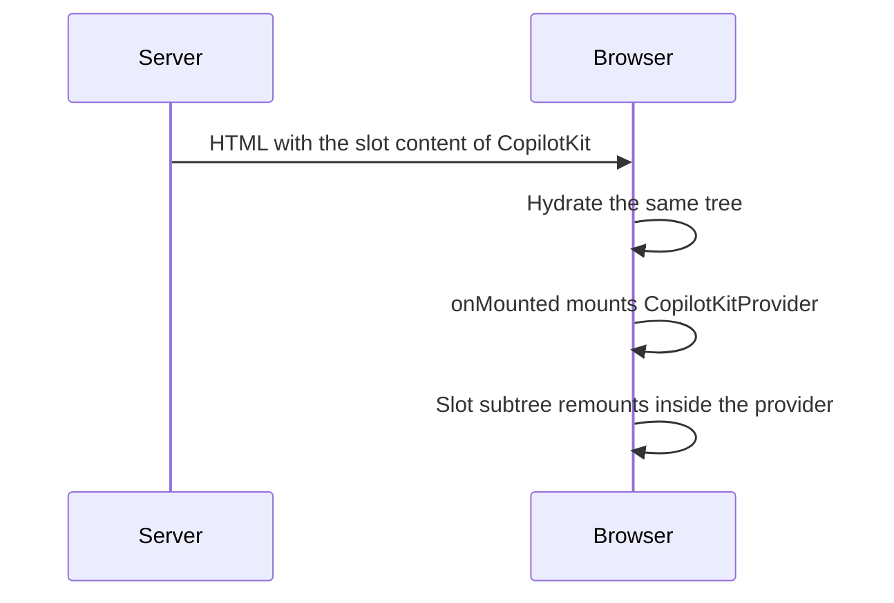

The server bundle never evaluates CopilotKit browser code.

## The `<CopilotKit>` wrapper

`<CopilotKit>` is a universal component. On the server and during hydration it renders only its slot, so the server HTML matches the client's first render. After mount it switches to the upstream `CopilotKitProvider`, so the wrapped subtree remounts once on the client. Keep heavy page state out of its direct children if that matters.

## Upstream components

The 30 upstream components are registered with `mode: 'client'`: the server renders nothing for them.

## Composables

`useCopilotGenUI` and `useCopilotHITL` return immediately on the server.

## Build settings

The module adds `@copilotkit/vue` to `build.transpile` and, with `styles: true`, pushes `@copilotkit/vue/styles.css` to `css` once, globally.
