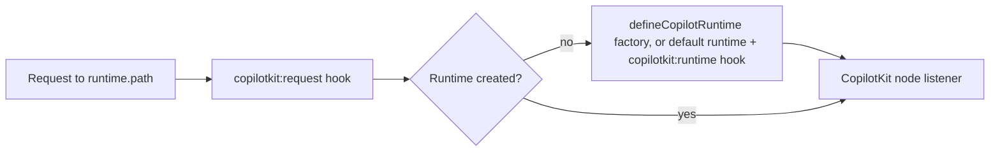

## When it is registered

The module registers a handler on `runtime.path` (default `/api/_copilotkit`) and on `runtime.path/**`, unless one of these applies:

- `runtime: false` disables every server registration.
- `runtime.url` is set: the client uses that external runtime instead.
- `runtime.enabled` is `false`.

`runtime.enabled` defaults to `true` when the app has a server runtime (`ssr` is not `false` and the output is not static) and to `false` otherwise. An explicit value wins.

The same resolved path is written to `runtimeConfig.public.copilotkit.runtimeUrl`, so the client can never point at a different route than the one registered.

The route needs `@copilotkit/runtime`; if it is missing, the module prints the install command.

## How the runtime is built

The runtime is created on the first request and reused afterwards. Concurrent first requests share one initialization, and a failed initialization is retried on the next request.

Without a [custom factory](/server/custom-runtime) the module builds it from runtime config:

- If `runtime.agents` has entries, each becomes a remote AG-UI agent. See [Remote agents](/guide/remote-agents).
- Otherwise a built-in agent is registered under the id `default` with `runtime.model` (default `openai/gpt-4o`).

The API key for the built-in agent is chosen from the model prefix:

| Model prefix | Key |
|---|---|
| `openai/` | `NUXT_COPILOTKIT_OPENAI_API_KEY` |
| `anthropic/` | `NUXT_COPILOTKIT_ANTHROPIC_API_KEY` |
| anything else | none; the upstream runtime looks up its own environment variables |

With `provider.debug` on, the server logs the registered agent ids once the runtime is created.
